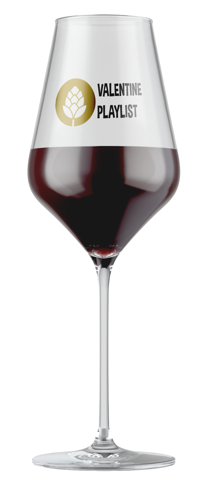

<figure class="wp-block-image alignwide size-large"></figure>

<h2 class="has-text-align-center wp-block-heading">This Valentine let the music speak for you!</h2>

<figure class="wp-block-image alignright size-large is-resized"></figure>

Valentine's Day is a special day for many of us. It's a day to show our love and appreciation for the people we care about, but it can also be a time to reflect on our own feelings of love, loneliness, and longing. 

Whether you're single, taken, or somewhere in between, my Valentine Playlist has something for everyone. From love songs to breakup anthems. 

I created this playlist full of tracks that will make you feel less alone and more connected to others. 

Turn up the volume and get ready to experience an emotional audio landscape! 

Grab a glass of wine and enjoy some tunes that will help you celebrate this day. As we explore the best and worst of Valentine's Day songs.

<iframe style="border-radius:12px" src="https://open.spotify.com/embed/playlist/2h41eUYU7JJjWblt3CEJQw?utm_source=generator" width="100%" height="650" frameborder="10" allowfullscreen="" allow="autoplay; clipboard-write; encrypted-media; fullscreen; picture-in-picture" loading="lazy"></iframe>

<h3 class="has-text-align-center has-x-large-font-size wp-block-heading">Help Create the Top 100 Valentine Songs </h3>

With so many Valentine songs out there, it is hard to narrow it down to the Top 100. That's where you come in. <em>I need your help </em>to get my playlist down to the <strong>Top 100 Valentine Songs</strong> by asking you which tracks to remove. Or should I make the playlist the Top 200?

Comment on this post which tracks you would like me to remove from the playlist. <strong>We can make this the best Valentine Playlist!</strong> 

<figure class="wp-block-video"><video height="1920" style="aspect-ratio: 1080 / 1920;" width="1080" autoplay controls loop muted src="https://betterworldwithdesign.com/wp-content/uploads/2023/01/Valentines-day.-Instagram-story.-Happy-valentines-day.-post.mp4"></video></figure>

<h2 class="wp-block-heading">Mix by Tempo</h2>

Valentine Playlist Mixed by Tempo is a revised playlist for Valentine's Day that includes 12 songs by various recording artists. This playlist is a shorter version of a larger playlist and is mixed by tempo below 70 and above 140, making it a great option for easy listening.

<iframe style="border-radius:12px" src="https://open.spotify.com/embed/playlist/4YhzyZTCZAABvRipB73DrW?utm_source=generator" width="100%" height="352" frameBorder="0" allowfullscreen="" allow="autoplay; clipboard-write; encrypted-media; fullscreen; picture-in-picture" loading="lazy"></iframe>
 

