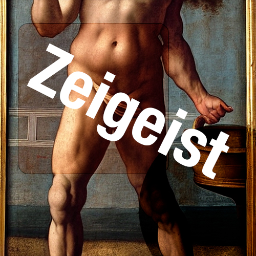

<figure class="wp-block-image aligncenter size-full"></figure>

<strong>Zeigeist</strong> was a Swedish electronic music duo consisting of Pearl and producer Hampus Klint. The band was formed in 2006 and was active until 2009. Their music style can be described as a mixture of electronic, pop, and shoegaze.

Their debut album, "The Jade Motel," was released in 2008 and received positive reviews from music critics.  The album features tracks such as "Humanitarianism", "Tar Heart", and "Bunny" which showcase the band's ability to pay homage to electronic signature sounds. One of the standout tracks on the album is "Bunny," which features a sample from the iconic electronic band Depeche Mode.

Zeigeist's music has been described as dreamy and ethereal, with haunting vocals and catchy melodies. The band's lyrics often explore themes of love, loss, and the human condition.

In addition to their studio albums, Zeigeist released several EPs and singles throughout their career. Some of their most popular tracks include "Cuffs," "Wrecked Metal," and "Falsehearted."

Despite their relatively short career, Zeigeist made a significant impact on the electronic music scene. Their music continues to be appreciated by fans of the genre and serves as a testament to the band's creative vision and unique sound.

<iframe loading="lazy" style="border-radius:12px" src="https://open.spotify.com/embed/playlist/1iLW8HJK4m1qrJbWwgXTK0?utm_source=generator" width="100%" height="380" frameborder="0" allowfullscreen="" allow="autoplay; clipboard-write; encrypted-media; fullscreen; picture-in-picture"></iframe>

<h4 class="wp-block-heading">Stand Out Tracks </h4>

<strong><a href="https://open.spotify.com/track/3opcYdpWJCgQdpi7tLb2YG?si=0aede9cce1de48b5" data-type="URL" data-id="https://open.spotify.com/track/3opcYdpWJCgQdpi7tLb2YG?si=0aede9cce1de48b5">Bunny</a></strong> - The sample used in "Bunny" is from Depeche Mode's song "Just Can't Get Enough". The sample is used in the chorus of "Bunny" and adds a haunting and dreamy quality to the track, which is typical of Zeigeist's music.

<strong><a href="https://open.spotify.com/track/26IoZIoBgNbQAp6XPooV6l?si=6b9e87088bfc47ff" data-type="URL" data-id="https://open.spotify.com/track/26IoZIoBgNbQAp6XPooV6l?si=6b9e87088bfc47ff">Humanitarianism</a></strong> - After listening to Zeitgeist band song "Humanitarianism", it is clear that the song has a similar sound to the Swedish indie band The Knife. The electronic beats, synth sounds and the overall production of the song is reminiscent of The Knife's style.

The vocals in "Humanitarianism" are also similar to The Knife's lead vocalist, Karin Dreijer. The raw, emotional delivery of the lyrics and the haunting quality of the vocals are comparable to The Knife's signature sound.

Overall, if you enjoy The Knife's music, it is highly likely that you will enjoy Zeitgeist band's "Humanitarianism". The similarities between the two bands are remarkable and worth exploring for fans of electronic indie music.

<strong><a href="https://open.spotify.com/track/2hTtC19X2pdru8KCx5uIYJ?si=d2623eaef8744dc5" data-type="URL" data-id="https://open.spotify.com/track/2hTtC19X2pdru8KCx5uIYJ?si=d2623eaef8744dc5">Tar Heart</a>  </strong>- The Tar Heart song by Zeitgeist band has often been compared to the music style of New Order. The band's unique sound and style, which combines elements of post-punk, new wave, and electronic music, has been a favorite amongst fans of the genre.

The chorus notes and the use of synthesizers immediately draw comparisons to the iconic sound of New Order. However, the band's distinct voice and lyrics set it apart, making it a standout track in its own right.

Overall, Tar Heart is a great example of Zeitgeist's musical talent and their ability to pay homage to the greats while still creating something new and exciting.

<a href="https://open.spotify.com/track/0jtJgeMvJbybrvOqFNKAWm?si=7f3ab8b535f746c7" data-type="URL" data-id="https://open.spotify.com/track/0jtJgeMvJbybrvOqFNKAWm?si=7f3ab8b535f746c7" target="_blank" rel="noreferrer noopener">Dawn // Night</a> - One of their notable works is the song "Dawn // Night," which draws inspiration from several well-known sources.

Firstly, the song takes a direct sample from The Knife's "Heartbeats" song. In "Heartbeats," the duo creates an ethereal and dreamy soundscape that has become iconic in the world of electronic music. Zeitgeist takes this sample and uses it as the foundation for "Dawn//night," building upon it with their own creative ideas and production techniques.

Another influence on "Dawn//night" is the Eurythmics' "1984" album. This album was released in 1984 as a soundtrack to the film adaptation of George Orwell's novel, "1984." The album features a dark and brooding sound that perfectly captures the dystopian themes of the novel. Zeitgeist channels this same feeling in "Dawn//night," creating a sense of unease and tension that permeates throughout the track.

Finally, the vocals in "Dawn // Night" have a distinct Scissor Sisters vibe. Scissor Sisters are an American pop band known for their flamboyant stage presence and catchy, danceable tracks. Zeitgeist takes this influence and uses it to create a vocal performance that is both energetic and emotive.

"Dawn // Night" is a unique and creative track that draws from several different influences to create something truly original. By blending the sounds of The Knife, the Eurythmics, and Scissor Sisters, Zeitgeist has created a song that stands out in the crowded world of electronic music.

<strong>VIDEO Chasing Your Shadows All Around the World </strong>

<figure class="wp-block-embed is-type-video is-provider-youtube wp-block-embed-youtube wp-embed-aspect-16-9 wp-has-aspect-ratio">

<iframe loading="lazy" title="Zeigeist - Chasing Your Shadows All Around the World [Music Video]" width="1080" height="608" src="https://www.youtube.com/embed/DuLj3ois_rc?feature=oembed" frameborder="0" allow="accelerometer; autoplay; clipboard-write; encrypted-media; gyroscope; picture-in-picture; web-share" referrerpolicy="strict-origin-when-cross-origin" allowfullscreen></iframe>

</figure>
