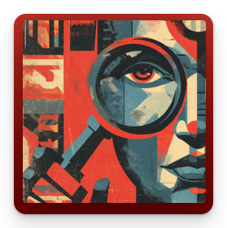
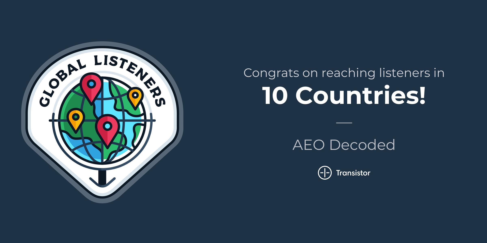

<h2>AEO Decoded Goes International: Celebrating Listeners in 10 Countries<!-- notionvc: b0182e9f-4c3c-49fa-bd87-c75b82fd76da --> <!-- notionvc: 1b2c6269-956e-4db3-8e28-8379081e94bd --></h2>

It's with genuine excitement that I share our latest podcast milestone — AEO Decoded has officially reached listeners in 10 countries around the world! This global reach demonstrates the growing interest in Answer Engine Optimization as content creators worldwide prepare for the AI-driven search revolution.

For a podcast focused on such a niche topic, reaching this international audience in just a few short weeks is truly humbling. I want to express my deepest gratitude to each and every one of you who has listened, shared, and supported this journey.

<h3>Our Global Audience</h3>

Our listeners span multiple continents, with the first episode being enjoyed across:

<ul>
<li>🇺🇸 United States</li>
<li>🇬🇧 United Kingdom</li>
<li>🇳🇿 New Zealand — where we've reached #1 in the "How To" category!</li>
<li>🇪🇸 Spain</li>
<li>🇷🇴 Romania</li>
<li>🇨🇿 Czech Republic</li>
<li>🇩🇪 Germany</li>
<li>🇩🇰 Denmark</li>
<li>🇻🇳 Vietnam</li>
<li>🇨🇷 Costa Rica</li>
<li>🇳🇴 Norway</li>
<li>🇳🇱 Netherlands</li>
<li>🇨🇦 Canada</li>
<li>🇸🇰 Slovakia</li>
<li>🇹🇷 Turkey</li>
</ul>
<h3>Milestone Collection Growing</h3>

This international achievement joins our other recent milestones:

<ul>
<li><strong>100+ total downloads</strong> for the podcast series</li>
<li><strong>50+ downloads</strong> for a single episode</li>
<li><strong>#1 ranking</strong> in the "How To" category in New Zealand</li>
</ul>

What makes these achievements particularly special is the community that's forming around the show. Just this week, a work partner mentioned she went to check out my podcast and discovered she was already following it! These organic connections are exactly what makes this journey worthwhile.

<h3>What's Coming Next</h3>

As we approach the Season One finale dropping on October 2, I'm excited to announce that our FREE AEO Track Template will help you implement everything you've learned about optimizing content for AI search. If you've been following along, this practical tool will make your AEO implementation significantly easier.

And looking beyond the horizon — I'm thrilled to announce our next podcast series, <strong>GEO Decoded</strong>, focused on Generative Engine Optimization. Following the same accessible format, this new series will guide you through optimizing content specifically for AI systems that generate new content.

Thank you again for being part of this global community of forward-thinking content creators. Let's continue to build the future of content optimization together!

Listen to the latest episode: <a href="https://betterworldwithdesign.com/aeo-decoded/">AEO Decoded</a>

<!-- notionvc: 8b2915ab-d525-45c6-b1d8-7d414041fcda -->

<h2>Listen to the latest episode • AEO DECODED<!-- notionvc: b341f870-4633-4f5d-8b47-50c2bde9df7a --></h2>

<strong>AEO Decoded — the podcast demystifying Answer Engine Optimization. </strong>Practical, fast-paced episodes with real examples and takeaways

<!-- notionvc: dd33231d-ddc6-40ec-b40e-04993ddab468 -->

<a class="et_pb_button_0 et_pb_button et_pb_bg_layout_light et_pb_module et_block_module" href="https://betterworldwithdesign.com/?page_id=5624">Listen to the Free Podcast Series</a>

<h2 style="text-align: center;">AEO Decoded Podcast</h2>

