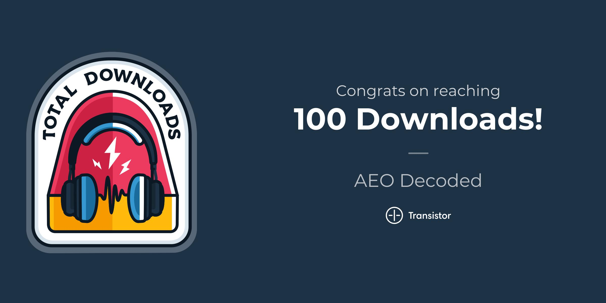

<h1>The Community Behind the Numbers: Your Support Matters<!-- notionvc: e2cbe584-9f89-49b4-8a7d-f8ca142d8329 --></h1>

I'm thrilled to share that AEO Decoded has reached a significant milestone of 100 downloads! As we prepare for our Season One finale next week, I want to extend my deepest gratitude to all our listeners who have made this journey possible.

What started as a mission to demystify Answer Engine Optimization has grown into a global community of forward-thinking content creators preparing for the AI-driven future of search. Your questions, feedback, and enthusiasm have been the driving force behind this podcast.

<h2>Season One Finale: The Complete AEO Fundamentals</h2>

Next week marks the conclusion of our first season with Episode 10: "Measuring AEO Success: Beyond Traditional Metrics." This special finale episode will tie together all the fundamental concepts we've explored throughout the season, providing you with a comprehensive framework for implementing AEO in your content strategy.

But that's not all—I'm excited to announce that all finale listeners will receive a FREE AEO Track Template that you can use to implement everything you've learned and measure your progress. This template will help you:

<ul>
<li><strong>Organize your content:</strong> Structure your articles around the question-based format we discussed in Episode 2.</li>
<li><strong>Track implementation:</strong> Monitor which AEO elements you've added to which content pieces.</li>
<li><strong>Measure results:</strong> Record metrics that matter in the age of AI search.</li>
<li><strong>Plan improvements:</strong> Identify opportunities to enhance your content's AI visibility.</li>
</ul>
<h2>What 100 Downloads Means for AEO</h2>

Reaching 100 downloads in this emerging field is particularly significant. It demonstrates the growing recognition that as AI becomes the primary interface between people and information, content creators must adapt their strategies.

We've also reached some exciting regional milestones:

<ul>
<li><strong>Top ranking in New Zealand:</strong> #1 in the "How To" category.</li>
<li><strong>International reach:</strong> Listeners in 10 countries and growing.</li>
<li><strong>Consistent growth:</strong> Week-over-week increases in listener numbers.</li>
</ul>
<h2>Looking Ahead to Season Two</h2>

While Season One has focused on the fundamentals of AEO, I'm already planning Season Two where we'll explore advanced techniques, case studies, and practical applications across different industries. Based on your feedback, we'll also be diving deeper into case studies and real-world examples from content creators who have successfully implemented AEO strategies.

Following our successful AEO Decoded format, I'm also excited to announce our next podcast series: GEO Decoded, which will guide you through optimizing content for generative engines. Stay tuned for the launch date!

<h2>Your Action Item</h2>

As we prepare for the finale, I have one request: If you've implemented any AEO strategies from the podcast, please share your experience. What worked? What challenges did you face? Your insights will help shape our future episodes and resources.

<strong>Subscribe now to ensure you receive the Season One finale episode with your free AEO Track Template next Thursday, October 2nd.</strong>

<!-- notionvc: 365a5ac6-fc6d-4c94-8cec-b838b352d1ef -->

<!-- form.123formbuilder.com script begins here -->

<!-- form.123formbuilder.com script ends here -->

<h2>Listen to the latest episode • AEO DECODED<!-- notionvc: b341f870-4633-4f5d-8b47-50c2bde9df7a --></h2>

<strong>AEO Decoded — the podcast demystifying Answer Engine Optimization. </strong>Practical, fast-paced episodes with real examples and takeaways

<!-- notionvc: dd33231d-ddc6-40ec-b40e-04993ddab468 -->

<a class="et_pb_button_5 et_pb_button et_pb_bg_layout_light et_pb_module et_block_module" href="https://betterworldwithdesign.com/?page_id=5624">Listen to the Free Podcast Series</a>

<h2 style="text-align: center;">AEO Decoded Podcast</h2>

