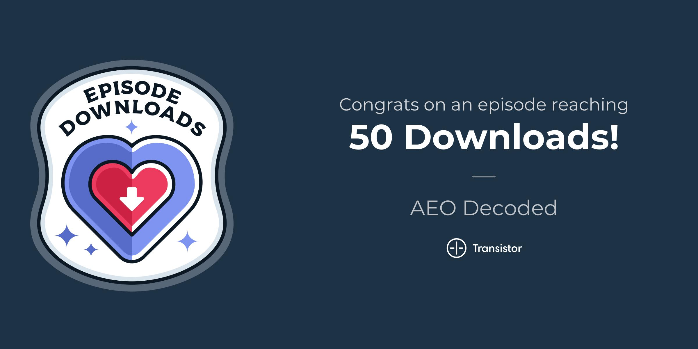

A massive thank you to everyone who's been tuning into AEO Decoded! We've hit 50 downloads this week, and while that might seem modest to some, in the emerging field of Answer Engine Optimization, it represents something significant - a growing community of forward-thinking content creators who recognize that the search landscape is fundamentally changing.

One question that came up repeatedly from listeners this week was: "Is AEO only relevant for technical or educational content?" It's a fair question, and one I addressed in our first episode's Q&amp;A lightning round.

<h2>Beyond Technical Content: AEO For Everyone</h2>

The short answer is absolutely not! Whether you're a food blogger sharing recipes, an artist selling prints, a small business owner with a local shop, or a corporate marketing team - AEO strategies apply to all content types.

The misconception stems from seeing AI systems as purely technical tools, when in reality they're becoming the primary interface between people and information. When someone asks an AI assistant about the "best coffee shop in Dublin with outdoor seating," they're not just looking for technical information - they want recommendations, ambiance descriptions, maybe even the story behind your business.

<h2>Real-World Applications Across Industries</h2>

Let's look at how different content creators can benefit from AEO principles:

<ul>
<li><strong>Creative content:</strong> Storytellers and artists can structure their work to be discoverable when people ask for specific themes, emotional experiences, or creative inspirations. Imagine someone asking, "Show me a poem about resilience" and having your work featured.</li>
<li><strong>E-commerce:</strong> Product descriptions can be optimized to appear when consumers ask specific questions about solving problems, rather than just searching for product categories. Instead of just showing up for "waterproof jackets," you might be the answer to "What should I wear hiking in Ireland during rainy season?"</li>
<li><strong>Service businesses:</strong> Local services can optimize for context-specific queries like "Who can fix a leaking toilet on Sunday in south Dublin?" by addressing emergency availability and service areas explicitly in their content.</li>
<li><strong>Personal brands:</strong> Consultants and coaches can structure their expertise to be cited when AI assistants generate advice or strategies in their field, establishing authority without direct promotion.</li>
</ul>
<h2>The Principles Remain Consistent</h2>

While applications vary, the core principles we've been discussing in the podcast remain consistent across all content types:

<ul>
<li><strong>Question-based structure:</strong> Organize information around the specific questions your audience is asking, regardless of your industry.</li>
<li><strong>Clear, direct answers:</strong> Provide explicit, concise answers immediately after each question.</li>
<li><strong>Structured data:</strong> Use appropriate <a href="http://Schema.org">Schema.org</a> markup to help AI systems understand what your content is about.</li>
<li><strong>Entity optimization:</strong> Clearly define the key concepts, people, places, products, or services you discuss.</li>
</ul>
<h2>Northern Irish Wisdom: "Dead On" Content Strategy</h2>

As I often say on the podcast (with my distinctive Northern Irish accent), creating AI-friendly content is "pure dead brilliant for users, so it is." When you structure your content to work well with AI systems, you're actually making it more useful for humans too.

The reason is simple: AI systems are designed to understand and deliver what humans actually want. By optimizing for these systems, you're focusing on clarity, relevance, and addressing real user needs - all qualities that make your content more valuable to human readers as well.

<h2>The Takeaway</h2>

As we continue to explore AEO topics each week, remember that these strategies aren't just for "techie" content. They're for anyone who wants their information to be found and used in the era of AI-powered search.

If you haven't yet implemented the question-based content structure we discussed in Episode 2, that's your action item for this week. Take your most popular piece of content and restructure it around 3-5 key questions your audience asks about that topic. This simple change can dramatically improve how AI systems understand and use your content.

Thank you again for being part of this journey. If you've implemented any AEO strategies from the podcast, I'd love to hear about your results. And if you haven't subscribed yet, each Thursday brings a new 7-minute episode packed with practical advice you can implement right away.

Until next time, I'm Gary Crossey, helping you make your content speak AI.

<!-- notionvc: 416fb91f-7249-4fb0-9f37-db38ffd3d3b4 --> <!-- notionvc: 397c1496-63ea-4f5b-97d0-aa11eca2818b -->

<h2>Listen to the latest episode • AEO DECODED<!-- notionvc: b341f870-4633-4f5d-8b47-50c2bde9df7a --></h2>

<strong>AEO Decoded — the podcast demystifying Answer Engine Optimization. </strong>Practical, fast-paced episodes with real examples and takeaways

<!-- notionvc: dd33231d-ddc6-40ec-b40e-04993ddab468 -->

<a class="et_pb_button_10 et_pb_button et_pb_bg_layout_light et_pb_module et_block_module" href="https://betterworldwithdesign.com/?page_id=5624">Listen to the Free Podcast Series</a>

<h2 style="text-align: center;">AEO Decoded Podcast</h2>

