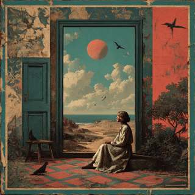

<iframe loading="lazy" width="100%" height="180" frameborder="no" scrolling="no" seamless="" src="https://share.transistor.fm/e/99964804"></iframe>

For years, Better World With Design has been my creative playground. In 2026, that changes. We will move from reactive creation to intentional curation, and we will anchor our diverse interests in a single, focused mission: amplifying voices that have been systematically marginalized in our cultural conversations.

That mission plays out across three core pillars:

<ul class="wp-block-list">
<li><strong>Design as a tool for social good.</strong></li>

<li><strong>Literature as a lens on power and justice.</strong></li>

<li><strong>Technology has both promise and peril in pursuiting equity.</strong></li>
</ul>

This shift doesn’t abandon what made this blog meaningful. The book reviews, photography essays, music discoveries, and design insights that have defined BWWD remain at our core; they’re just being asked to pull in the same direction.

It also marks a structural shift: <strong><a href="https://aeodecoded.ai/">AEO Decoded</a></strong>, the podcast and educational work on Answer Engine Optimization, moves to its own dedicated site and publishing cadence, freeing Better World With Design to focus fully on design, literature, technology, and community storytelling.

Alongside the written work, 2026 also marks a new chapter for <strong><a href="https://open.spotify.com/artist/0ABWAxqIZiHC6ScjYmM6Ch?si=4UV8ouJmSRG7ppT8tKCLDw">Answer Engine</a></strong>, my music project. The response to the 2025 releases was so good that I'm excited to release more music in 2026, treating songwriting and production as another way of thinking through justice, memory, and place, not as a bid for late-life pop stardom, but as an honest practice of making music and writing words that fit the world we're trying to build.

<figure class="wp-block-embed is-type-rich is-provider-spotify wp-block-embed-spotify wp-embed-aspect-21-9 wp-has-aspect-ratio">

<iframe title="Spotify Embed: The Answer Engine" style="border-radius: 12px" width="100%" height="352" frameborder="0" allowfullscreen allow="autoplay; clipboard-write; encrypted-media; fullscreen; picture-in-picture" loading="lazy" src="https://open.spotify.com/embed/artist/0ABWAxqIZiHC6ScjYmM6Ch?si=4UV8ouJmSRG7ppT8tKCLDw&amp;utm_source=oembed"></iframe>

</figure>

<h2 class="wp-block-heading"><strong>The Vision: From Playground to Platform</strong></h2>

For the past several years, Better World With Design has been exactly what its evolution suggested, a space where design philosophy, social commentary, creative work, and personal reflection intersected without apology. We explored Montaigne's essays alongside web accessibility guidelines. We analyzed Demon Copperhead while discussing Answer Engine Optimization. We celebrated experimental music while documenting rural tech initiatives.

This eclecticism wasn't confusion; it was authentic curiosity. But authenticity without direction can become diffusion. In 2026, we're bringing intentionality to that curiosity by organizing the work around those three pillars and being explicit about whose stories, histories, and futures we’re centering.

<figure class="wp-block-image alignright size-full is-resized"></figure>

Within that, 2026 also introduces <strong><a href="https://betterworldwithdesign.com/belfast-stories/">Belfast Stories</a></strong> as a recurring BWWD series: place-based essays grounded in Belfast streets, buildings, routes, and sounds, using memory, photography, and narrative to examine how design, class, history, and community shape everyday life.

<h2 class="wp-block-heading"><strong>Feature: Voices from the Margins</strong></h2>

The most significant addition to BWWD in 2026 is the Voices from the Margins series, a recurring feature that centers writers, thinkers, and creators whose perspectives have been excluded from the mainstream literary canons and cultural conversations.

This series matters because representation isn't just about who gets published; it's about whose realities are validated, whose experiences are deemed worth preserving, and whose visions shape our collective imagination. For too long, the literary canon has reflected a narrow slice of human experience-primarily Western, primarily male, primarily reflecting the perspectives of the powerful.

Voices from the Margins deliberately seeks out the alternatives: LGBTQ+ writers from the early 20th century who wrote in code and metaphor because openness meant danger. Women authors who published under male pseudonyms or saw their work attributed to men. Indigenous writers documented cultural genocide even as it occurred. Writers of color chronicling resistance and resilience in systems designed to erase them.

<h2 class="wp-block-heading"><strong>What to Expect in 2026</strong></h2>

The editorial calendar for 2026 reflects this intentional evolution while keeping the creative range that has always defined BWWD.

<h3 class="wp-block-heading"><strong>Monthly Features</strong></h3>

<ul class="wp-block-list">
<li><strong><a href="https://betterworldwithdesign.com/category/book-reviews-reading-lists/voices-from-the-margins/">Voices from the Margins</a> (monthly): </strong>These are public domain writers whose work has been systematically excluded from literary canons, and this will include historical context, close reading, and links to present-day movements.</li>

<li><strong><a href="https://betterworldwithdesign.com/belfast-stories/">Belfast Stories</a> (monthly):</strong> Place-based essays rooted in Belfast streets, bridges, estates, venues, and routes, using memory, photography, and narrative to explore community, class, conflict, and everyday design.</li>

<li><strong><a href="https://betterworldwithdesign.com/tag/montaigne/">Design Philosophy Essays</a>:</strong> Design as a tool for social good, focusing on accessibility, equity, and power in digital and physical spaces.</li>

<li><strong><a href="https://betterworldwithdesign.com/photography/">Photography Essays</a>:</strong> Documentary and experimental photography that traces place, community, and change.</li>

<li><strong><a href="https://betterworldwithdesign.com/tag/book-review/">Book Reviews</a>:</strong> Reading through a justice lens, looking at how authors handle power, identity, resistance, and transformation.</li>

<li><strong><a href="https://betterworldwithdesign.com/tag/music/">Music Discovery</a>:</strong> Artists and genres that push against the center, with attention to experimental and historically marginalized voices.</li>

<li><strong><a href="https://betterworldwithdesign.com/tag/community-tech/">Technology and Ethics</a>:</strong> How technology mediates justice, privacy, and equity, grounded in data ethics and accessibility work.</li>
</ul>

<h3 class="wp-block-heading"><strong>Why Public Domain Literature?</strong></h3>

A practical note: this series focuses on public domain works, which means most featured writers died before 1955. This isn't a limitation; it's an opportunity. These texts are freely accessible, allowing readers to engage directly without financial barriers. More importantly, this historical focus shows how long these voices have existed and how deliberately someone suppressed them.

When we read Zitkala-Sa's "The School Days of an Indian Girl" or José Martí's revolutionary poetry, we're not discovering obscure curiosities. We are recovering essential perspectives that systematically excluded stories about our literature, history, and culture.

<figure class="wp-block-embed is-type-video is-provider-youtube wp-block-embed-youtube wp-embed-aspect-16-9 wp-has-aspect-ratio">

<iframe loading="lazy" title="Voices from the Margins - AUDIOBOOK - The School Days of an Indian Girl by Zitkala Sa" width="1080" height="608" src="https://www.youtube.com/embed/Z0t5xyTfZvQ?feature=oembed"  allow="accelerometer; autoplay; clipboard-write; encrypted-media; gyroscope; picture-in-picture; web-share" referrerpolicy="strict-origin-when-cross-origin" allowfullscreen></iframe>

</figure>

<h3 class="wp-block-heading"><strong>Series and Recurring Themes</strong></h3>

Several thematic threads will weave through the year's content:

<ul class="wp-block-list">
<li><strong>The Documentary Impulse:</strong> Connecting historical documentary photography (Timothy O'Sullivan, Carleton Watkins, Alexander Gardner) with contemporary visual storytelling and the ethics of representation.</li>

<li><strong>Literature and Resistance:</strong> Examining how writers document, resist, and imagine alternatives to oppressive systems, from Indigenous authors chronicling cultural genocide to LGBTQ+ writers creating coded narratives of survival.</li>

<li><strong>Design Justice in Practice:</strong> Applying design justice principles to real-world scenarios, from web accessibility to community-centered technology initiatives.</li>

<li><strong>Philosophy and Everyday Life:</strong> Continuing our engagement with thinkers like Montaigne, exploring how philosophical frameworks illuminate contemporary challenges.</li>
</ul>

<h3 class="wp-block-heading"><strong>Community Engagement</strong></h3>

Better World With Design has always been a conversation, not a monologue. In 2026, we're deepening our commitment to community engagement through:

<ul class="wp-block-list">
<li><strong>Open Resources:</strong> All Voices from the Margins features will include links to freely accessible texts, bibliographies for further reading, and historical context documents.</li>

<li><strong>Response and Dialogue:</strong> Enhanced commenting and discussion features, with dedicated time for engaging with reader responses and questions.</li>

<li><strong>Accessibility Commitment:</strong> Continued focus on making all content accessible, including transcripts, alt text, and clear navigation structures.</li>
</ul>

<h2 class="wp-block-heading"><strong>Why Now? Why This Focus?</strong></h2>

The decision to center Voices from the Margins reflects both conviction and historical urgency. We live when marginalized perspectives are simultaneously more visible than ever and under renewed attack. Book-banning campaigns target LGBTQ+ content, Indigenous histories, and narratives of racial justice. Educational curricula whitewash historical atrocities. Cultural conversations about whose stories matter remain contested terrain.

Amplifying marginalized voices isn't just about representation, though representation matters deeply. It's about expanding our collective understanding of what's possible, what's been tried, what's been suppressed, and what's been sustained despite systematic erasure.

When we read Zitkala-Sa's accounts of forced assimilation in Indian boarding schools, we're not engaging with distant history. We're understanding the roots of ongoing trauma in Indigenous communities and recognizing the resilience that has preserved culture despite genocidal policies.

When we explore early LGBTQ+ literature written under the threat of criminalization and social destruction, we honor the courage it took to write truth into existence and recognize that many contemporary battles for equality are continuations of struggles that began generations ago.

When we center writers of color documenting resistance and creating visions of liberation, ‌alternative futures have always existed in the imaginations of those fighting for them.

<h2 class="wp-block-heading"><strong>Why Does This Focus Matter?</strong></h2>

This shift reflects personal growth: a deeper understanding that neutrality is impossible. After years of exploring curiosity without constraint, I see that freedom without direction can become its own constraint. By choosing to center certain voices and perspectives, I'm not limiting what Better World With Design can be-I'm focusing its power.

Every design decision, every platform choice, and every act of curation reflects a conscious value. In 2026, we will make these values explicit.

Better World With Design has always reflected my values: curiosity, critical analysis, commitment to justice, appreciation for beauty and craft. In 2026, we're making these values explicit in our content strategy.

<h2 class="wp-block-heading"><strong>Maintaining the Eclecticism</strong></h2>

The eclecticism remains, but the focus has shifted. Every post, from photography to design, will be connected by a shared, critical lens: attention to marginalized perspectives, analysis of power structures, celebration of creativity as resistance, and the recognition that beauty and justice are not separate concerns.

You'll still find photography essays exploring technical challenges and visual storytelling. Music reviews will continue celebrating experimental sound and genre-defying artists. Design philosophy posts will still range from Swiss typography to contemporary UX patterns. Book reviews will include science fiction, literary fiction, historical narratives, and philosophical texts.

When we explore documentary photography, we'll examine not just technical mastery but also the ethics of representation and whose stories get preserved. When we review music, we'll consider not just sonic innovation but also whose experiments get canonized and whose get forgotten. When we discuss design, we'll interrogate not just aesthetics but also accessibility, equity, and the distribution of power.

<h2 class="wp-block-heading"><strong>Looking Ahead</strong></h2>

2026 represents a commitment to showing up consistently with intentional content that serves both personal curiosity and collective liberation. It's ambitious, 52 weeks of focused, researched, thoughtful content. But it's also necessary.

The cultural conversations we need to have about justice, equity, representation, and power require sustained engagement, not just momentary attention. Building a more just world requires understanding how we got here, whose visions were suppressed along the way, and what alternatives have always existed in the margins.

Better World With Design has always been about exploring how we create, communicate, and build the world we want to inhabit. In 2026, we're making explicit that the world we want to inhabit centers justice, amplifies marginalized voices, and recognizes that design, in all its forms, is never neutral.

Welcome to 2026. Let's build something meaningful together.

<h2 class="wp-block-heading"><strong>Practical Details</strong></h2>

For those interested in following along:

<ul class="wp-block-list">
<li><strong>Publishing Schedule:</strong> New content every Wednesday, with occasional bonus features on Saturdays.</li>

<li><strong>Social Media:</strong> More engagement across platforms, with content snippets, historical photos, and ongoing conversations.</li>

<li><strong>Archive Access:</strong> All content remains freely accessible with enhanced tagging and navigation to help readers explore thematic connections.</li>

<li><strong>Community Guidelines:</strong> Comments and discussions are welcome, with moderation focused on maintaining respectful dialogue and centering marginalized voices.</li>
</ul>

Thank you for being a part of this journey. Whether you've followed Better World With Design from its earliest days or you're discovering it for the first time in 2026, your engagement, questions, challenges, and support make this work meaningful.

Here's to a year of intentional creation, sustained engagement, and collective exploration of how we build the world we want to inhabit.

Founder -&nbsp;

Gary Crossey

