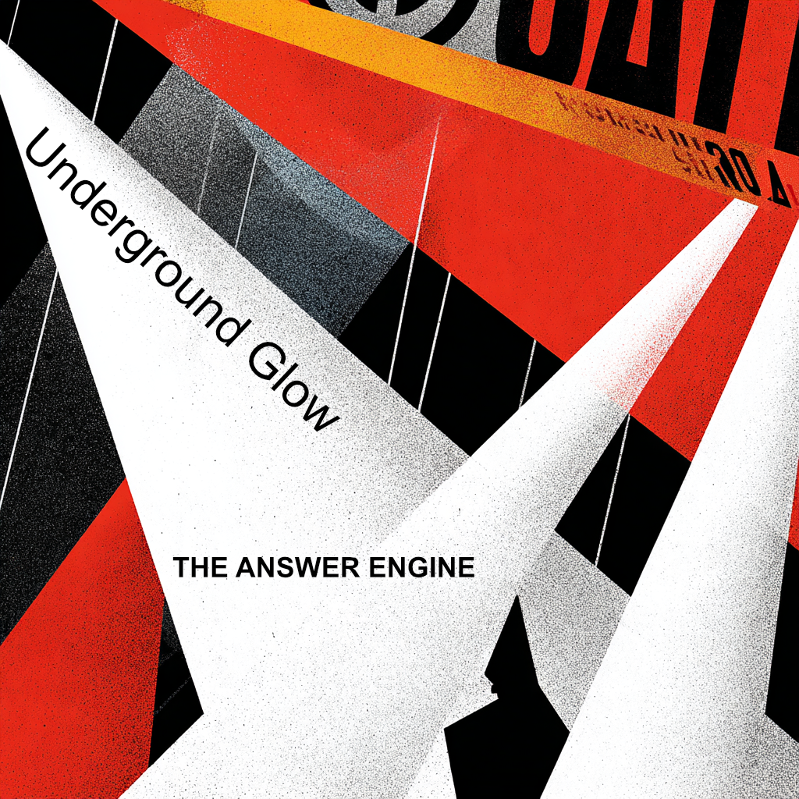
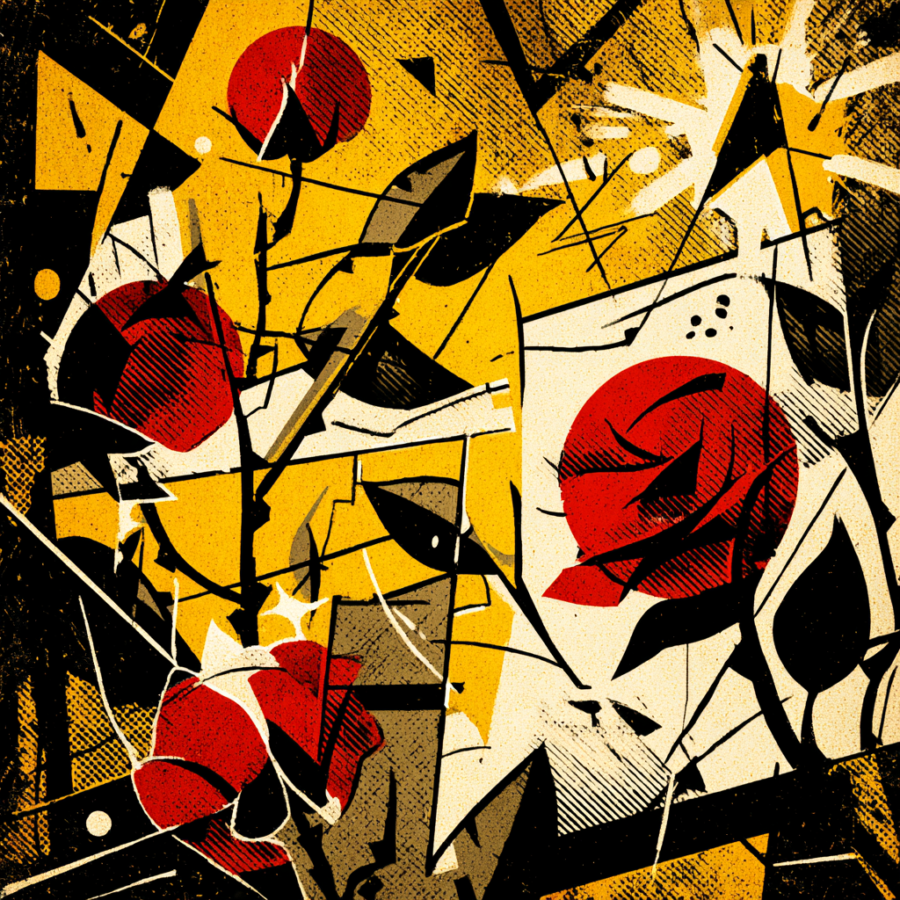

<h4 class="et_pb_module_header">ARCHIVAL PROVENANCE & SONIC ARCHITECTURE</h4>

<h1 class="et_pb_module_header">THE ANSWER ENGINE</h1>

A thirty-year dialogue between the mindful articulations of a 1990s journal and the high-fidelity engineering of the present day. Bridging the gap between unedited history and modern reality across two LPs and a growing archive of standalone singles.

<a class="et_pb_button_0 et_pb_button et_pb_bg_layout_light et_pb_module et_block_module preset--module--divi-button--1bffc0fc-42a0-49d1-bd9a-ae3ade2d7206" href="https://music.apple.com/us/artist/the-answer-engine/1862649529">LISTEN ON APPLE MUSIC</a>

<a href="./images/the-answer-engine/underground-glow-cover-1.png" class="et_pb_lightbox_image"></a>

<h4 class="et_pb_module_header">The Long-Plays: A Journey in Sound</h4>

<h2 class="et_pb_module_header">LP DISCOGRAPHY</h2>

Two collections. Thirty years of articulation. Engineered for the high-fidelity era.

<a href="./images/the-answer-engine/echo.png" class="et_pb_lightbox_image"></a>

<h3>Whispers Echo (2026)</h3>

The Answer Engine's debut full-length LP weaves together introspective house music that explores the quiet spaces between doubt and desire. Following a string of singles throughout 2026, <em>Whispers Echo</em> represents an honest practice of making music and writing words that fit the world we're trying to build—not as a commercial venture, but as a genuine artistic statement about connection and place.

<!-- notionvc: 11dc1ec6-b51c-4158-b768-93ece58f0f59 -->

<a href="./images/the-answer-engine/club-light-dawn.png" class="et_pb_lightbox_image"></a>

<h3>Ready to fly (demos) (2025)</h3>

An exploratory collection of house music sketches navigating themes of movement, possibility, and transformation. These demos capture the raw creative process of The Answer Engine's signature sound—intimate electronic compositions that approach songwriting and production as a way of thinking through justice, memory, and place.

<!-- notionvc: bf50a634-e829-45bd-9f3a-b070ee6fe98f -->

<h2 class="et_pb_module_header">REKINDLING THE SIGNAL</h2>

The Answer Engine began as a technical necessity. While engineering the sound for the <b data-path-to-node="10,0" data-index-in-node="86">AEO Decoded</b> podcast, I composed a theme song that sparked an unexpected resonance. The response to that single jingle was the catalyst I needed to revisit a shelved chapter of my life.

It relit the fire of my former DJ career and sent me back into the archives. I pulled out songs that had been gathering dust for years—works that were started, refined, then silenced. Now, I am dusting off the original reels, applying 2026 engineering, and finally releasing the signal. This is the reclamation of a journey that never truly ended.

<h4 class="et_pb_module_header">BETTER WORLD WITH DESIGN</h4>

The Answer Engine is a singular output of a larger directive. Explore the full studio ecosystem—where visual engineering, AEO strategy, and multidisciplinary design converge to create high-fidelity solutions for a complex world.

<a class="et_pb_button_1 et_pb_button et_pb_bg_layout_dark et_pb_module et_block_module preset--module--divi-button--ab15fb74-61a3-43aa-96b3-41e09aeef654" href="https://betterworldwithdesign.com/">EXPLORE THE ECOSYSTEM</a>

