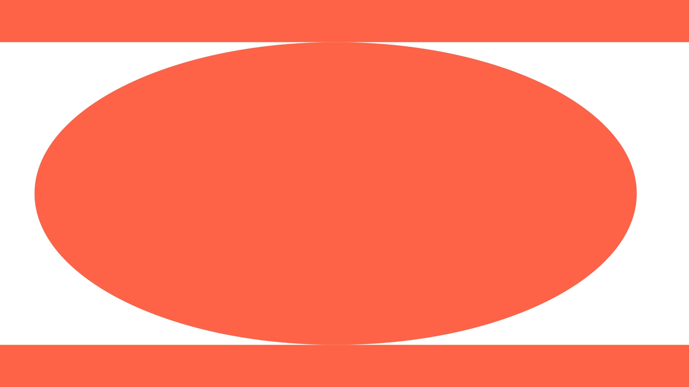

These four little loops are early sketches of an eye: lids closing, a pupil widening, a slow breath. They were my first tries at making a drawing move with nothing but the picture file itself. No video, no plug-in, no code running in the background.

  <figure><figcaption><b>The blink.</b> Two bars slide in like eyelids while the oval in the middle squashes flat, then everything opens again. One loop takes 12 seconds.</figcaption></figure>
  <figure><figcaption><b>The blink, again.</b> The same idea with a small change to the shapes, to see how much a detail changes the feel.</figcaption></figure>
  <figure><figcaption><b>The pupil.</b> Rings grow and shrink inside each other, like an eye adjusting to the light.</figcaption></figure>
  <figure><figcaption><b>The breath.</b> A simpler version: fewer rings, slower movement, more like breathing than looking.</figcaption></figure>

<h2>What you're looking at, in plain English</h2>

<strong>These are drawings, not videos.</strong> A video is a stack of photographs played one after another. Each of these is a single drawing made of a few shapes: some bars, a few circles and an oval. That's why each file is tiny, about the size of a short email.

<strong>The drawing carries its own instructions.</strong> Tucked inside each file is a short list of notes, a bit like stage directions: "at the start, the top bar is here; halfway through, it's moved down to here; at the end, it's back where it began." The web browser reads those notes and fills in every step between them, smoothly, many times a second.

<strong>Animators call those notes keyframes.</strong> Old cartoon studios worked the same way. A lead artist drew the important poses, the key frames, and assistants drew everything in between. Here the browser does the assistants' job.

<strong>Why it stays sharp.</strong> The file type is called SVG (scalable vector graphics). Instead of storing dots of colour, it stores shapes as measurements, like "a circle this wide, at this spot". So it looks crisp on a phone, a laptop or a cinema screen, and it never goes blurry when you zoom in.

<strong>Where it led.</strong> These blinking sketches turned into something bigger: a pair of eyes that follow your cursor around the page. You can see that in the <a href="/interactive-divi-eye-animation-a-living-plates-tutorial/">Living Plates eye animation tutorial</a>, and there's a cube that turns to look at your mouse on the <a href="/cube/">cube page</a>.

