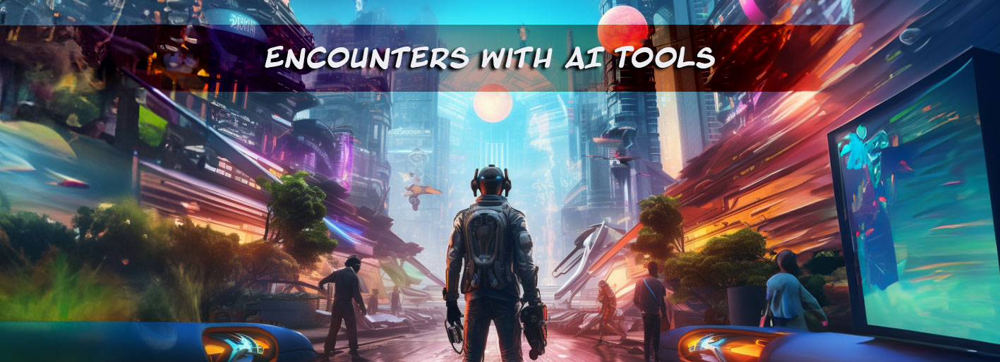
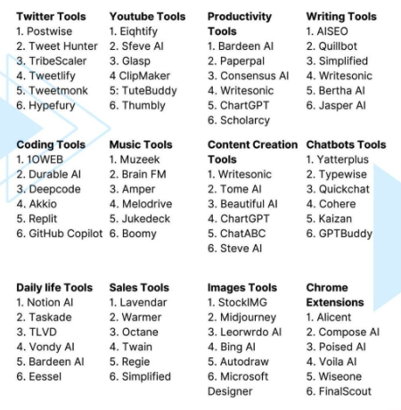

<h2 class="wp-block-heading">Encounters with AI Tools</h2>

I am always on the lookout for tools that can supercharge my productivity and streamline my work processes. In pursuit of this objective, I have invested considerable time and effort in meticulously researching and exploring the leading AI tools presently offered in the market.

In this super awesome blog, I spill the beans on my personal adventures with AI tools. Sharing some mind-blowing insights. Whether you're looking to conquer the world or just make your life a little easier, I've got you covered! Let the geeky fun begin!

I've gone ahead and sorted the tools into different categories to make your life easier. Whether you're looking for something to boost your productivity or improve your communication skills, I got you covered. Each category will be jam-packed with resources and links to help you find the perfect tool for all your needs. No more guesswork!

As I continue to test and learn more about each tool, I'll be sharing deep-dive blogs on each one, giving you an in-depth understanding of what each tool has to offer.

<ul class="wp-block-list">
<li>Cody - URL: <a rel="noreferrer noopener" href="https://meetcody.ai?fpr=gary14" data-type="URL" data-id="https://meetcody.ai?fpr=gary14" target="_blank">meetcody.ai</a></li>

<li>Writesonic - https://writesonic.com/ - Create SEO-optimized and plagiarism-free content for your blogs. </li>

<li>https://fireflies.ai/ - online meeting transcript </li>

<li>Book Summary - <a rel="noreferrer noopener" href="https://booksai.app/" data-type="URL" data-id="https://booksai.app/" target="_blank">booksai.app</a></li>

<li>Talk to books - https://aidepot.co/talk-to-books </li>

<li>Compose AI in Docs - https://www.compose.ai/pricing-for-loyal</li>

<li>Cheatlayer - automatic tasks - social media posts - https://cheatlayer.com/</li>
</ul>

<figure class="wp-block-image size-full"></figure>

<h2 class="wp-block-heading">Data Ai </h2>

<h3 class="wp-block-heading">Browse AI </h3>

Extract data from any website. Train robot in two minutes. 

URL: <a href="https://www.browse.ai/" data-type="URL" data-id="https://www.browse.ai/" target="_blank" rel="noreferrer noopener">browse.ai</a>

<h2 class="wp-block-heading">AI App Directory </h2>

<ul class="wp-block-list">
<li>https://www.vondy.com/</li>

<li><a rel="noreferrer noopener" href="https://www.futurepedia.io/" data-type="URL" data-id="https://www.futurepedia.io/" target="_blank">Futurepedia.io</a> - a large directory. Set up a free account and bookmark your favorite AI apps. I found the <a href="https://www.futurepedia.io/ai-tools" data-type="URL" data-id="https://www.futurepedia.io/ai-tools" target="_blank" rel="noreferrer noopener">Category AI List</a> easier to navigate. </li>
</ul>

<h2 class="wp-block-heading">Art Apps</h2>

<ul class="wp-block-list">
<li>https://leonardo.ai/ - Text to image</li>
</ul>

<h2 class="wp-block-heading">Photo Apps</h2>

<ul class="wp-block-list">
<li>https://durable.co/ - AI will Generate an image caption </li>
</ul>

<h2 class="wp-block-heading">Voice Apps</h2>

<ul class="wp-block-list">
<li>https://murf.ai/ - Voice over (interesting app. I couldn't locate the create your own voice that I went to the app for. The Basic yearly subscription works out at $9.50 per hour of video ($228 billed annually) upgrading reduces the hourly rate and increases hours of voice generation. </li>
</ul>

<h2 class="wp-block-heading">Video AI Apps </h2>

<ul class="wp-block-list">
<li>Tic-Tok - https://www.opus.pro/ </li>

<li>Runway - https://runwayml.com/ai-magic-tools/gen-2/</li>

<li>Modelscope - <a href="https://huggingface.co/spaces/fffiloni/zeroscope">https://huggingface.co/spaces/fffiloni/zeroscope</a></li>

<li>Synthesia - AI Avatars - https://www.synthesia.io/</li>

<li>Kaiber - Animation https://kaiber.ai/product</li>

<li>Wonder Studio - https://wonderdynamics.com/</li>

<li>Imagen - https://imagen.research.google/video/</li>

<li>Make a Video - https://makeavideo.studio/</li>

<li>Nvidia - https://research.nvidia.com/labs/toronto-ai/VideoLDM/</li>
</ul>

<h2 class="wp-block-heading">Web Design Apps </h2>

<ul class="wp-block-list">
<li>https://durable.co/ - Generate Websites </li>
</ul>

<h2 class="wp-block-heading">Music Apps </h2>

<ul class="wp-block-list">
<li>https://www.beatoven.ai/ - Create music</li>
</ul>

<h2 class="wp-block-heading">Video &amp; Animation Apps </h2>

<ul class="wp-block-list">
<li>https://pictory.ai/ - test to video projects </li>

<li>https://www.heygen.com/ - create AI video</li>

<li>https://kaiber.ai/ - animation </li>
</ul>

<h2 class="wp-block-heading">Podcast Apps </h2>

<ul class="wp-block-list">
<li>https://cleanvoice.ai/ - clean up your Podcast recording. </li>
</ul>

<h2 class="wp-block-heading">Diagram Apps </h2>

<ul class="wp-block-list">
<li>https://www.edrawsoft.com/ad/edrawmax/ - Create Mind Maps, Flow charts, from prompts visual presentation. </li>
</ul>

<h2 class="wp-block-heading">Social Media Apps </h2>

<ul class="wp-block-list">
<li>https://www.syllaby.io/ - create social media content. </li>

<li>CapCut - Free video editing with auto captions. </li>

<li>Captions - Offers playful captions options. </li>

<li>https://www.imagetocaption.ai - upload photo for social media caption and hashtags. </li>
</ul>

<h2 class="wp-block-heading">Email Apps </h2>

<ul class="wp-block-list">
<li>Twain - https://www.twain.ai/</li>
</ul>

<h2 class="wp-block-heading">Transcription Apps</h2>

<ul class="wp-block-list">
<li>Speak AI - https://speakai.co/</li>

<li>Trint - https://trint.com/</li>

<li>Otter -real-time transcriptions of meeting notes that are shareable, searchable, accessible, and secure - https://otter.ai/</li>

<li>Beey - https://www.beey.io/en/</li>

<li>Nova - generates captions - https://app.wearenova.ai/</li>

<li>Fireflies - transcribe, take notes, and complete actions during meetings - https://fireflies.ai/</li>

<li>&nbsp;Sonix - transcribe 30 minutes of audio or video in four minutes - https://sonix.ai/</li>

<li>Rev - well established - https://www.rev.com/ </li>

<li>Vertbit - live captioning and transcription, captioning, audio description, and translation and subtitles - https://verbit.ai/</li>

<li>Scribie - Fast service, low error rate - https://scribie.com/</li>
</ul>

<h2 class="wp-block-heading">Resources </h2>

<a href="https://petapixel.com/2023/06/01/so-who-owns-a-photo-expanded-by-adobe-generative-fill/">https://petapixel.com/2023/06/01/so-who-owns-a-photo-expanded-by-adobe-generative-fill/</a>

Add yes, there are even more AI tools. Notion AI is one of my personal favorites. <a href="https://www.marktechpost.com/author/arhamislam/">Arham Islam</a> list of 50+ New Cutting-Edge AI Tools is a nice range of AI Apps that most people can find a handful of brilliant new tools. 

<a href="https://www.marktechpost.com/2023/06/06/50-new-cutting-edge-ai-tools-2023/">https://www.marktechpost.com/2023/06/06/50-new-cutting-edge-ai-tools-2023/</a>

