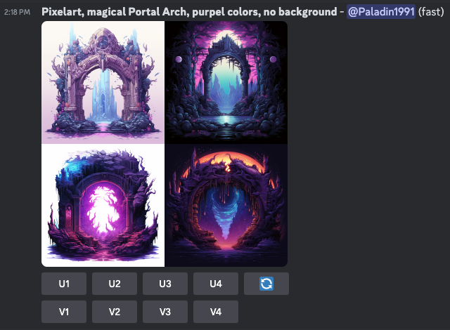
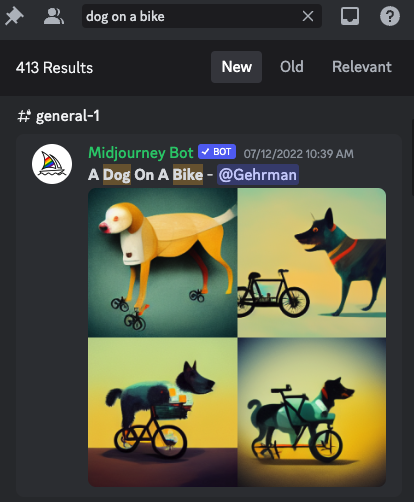

<h2 class="wp-block-heading">Where to find AI Apps</h2>

Find the right AI App for you. 

<figure class="wp-block-embed is-type-wp-embed is-provider-better-world-with-design wp-block-embed-better-world-with-design">

<blockquote class="wp-embedded-content" data-secret="b2CJlfPt7S"><a href="https://betterworldwithdesign.com/ai-apps/">AI Apps</a></blockquote><iframe loading="lazy" class="wp-embedded-content" sandbox="allow-scripts" security="restricted" style="position: absolute; visibility: hidden;" title="&#8220;AI Apps&#8221; &#8212; Better World With Design" src="https://betterworldwithdesign.com/ai-apps/embed/#?secret=I3qaSetCAe#?secret=b2CJlfPt7S" data-secret="b2CJlfPt7S" width="600" height="338" frameborder="0" marginwidth="0" marginheight="0" scrolling="no"></iframe>

</figure>

<h3 class="wp-block-heading">AI Prompt Example </h3>

My AI prompt can be applied to any hobby or anything you wish to learn.

<figure class="wp-block-embed is-type-wp-embed is-provider-better-world-with-design wp-block-embed-better-world-with-design">

<blockquote class="wp-embedded-content" data-secret="GrmWxlBpeo"><a href="https://betterworldwithdesign.com/unleashing-your-creativity-a-beginners-guide-to-using-ai-prompts-for-your-new-hobby/">AI Prompt for New Hobby</a></blockquote><iframe loading="lazy" class="wp-embedded-content" sandbox="allow-scripts" security="restricted" style="position: absolute; visibility: hidden;" title="&#8220;AI Prompt for New Hobby&#8221; &#8212; Better World With Design" src="https://betterworldwithdesign.com/unleashing-your-creativity-a-beginners-guide-to-using-ai-prompts-for-your-new-hobby/embed/#?secret=Kbtd8U84IO#?secret=GrmWxlBpeo" data-secret="GrmWxlBpeo" width="600" height="338" frameborder="0" marginwidth="0" marginheight="0" scrolling="no"></iframe>

</figure>

<h3 class="wp-block-heading">Midjourney AI Image Prompts</h3>

How to learn how to use MidJourney. 

<ol class="wp-block-list">
<li>Review what other people are using. </li>

<li>Use the Search Feature. </li>

<li>Develop a library of prompts.</li>
</ol>

<figure class="wp-block-image size-full"></figure>

<h3 class="wp-block-heading">Search User Results</h3>

Search - Dog on a bike (413 results) 

<figure class="wp-block-image size-full"></figure>

<h3 class="wp-block-heading">Midjourney Effects Prompts </h3>

<ul class="has-tertiary-background-color has-background wp-block-list">
<li>Cinematic, Depth of Field, insane details, intricate details,</li>

<li>Optical Fiber, elegant, hyper realistic,</li>

<li>beautifully Unreal Engine, Editorial Photography, Photography, Photoshoot, , Depth of Field, Super-Resolution, Megapixel, Pro Photo RGB, VR, Lonely, Good, Massive,</li>

<li>Half rear Lighting, Backlight, Natural Lighting, Incandescent, Moody Lighting, Cinematic Lighting, Studio Lighting, Soft Lighting, Volumetric, </li>

<li>Beautiful Lighting, Accent Lighting, Global Illumination, Screen Space Global Illumination, 4k</li>

<li>Ray Tracing Global Illumination, Optics, Scattering, Glowing, Shadows, Rough, Shimmering, Ray Tracing Reflections, Lumen Reflections, Screen Space Reflections, Diffraction Grading, Chromatic Aberration,</li>

<li>Post Processing, Post-Production, Cell Shading, Tone Mapping, insanely detailed and intricate, hyper maximalist,</li>

<li>super detailed, dynamic pose, photography, volumetric, photorealistic, ultra photoreal, ultra-detailed, intricate details,</li>

<li>ambient occlusion, sherif, pixelart, volumetric lighting, high contrast, HDR, 8K</li>
</ul>

<h3 class="wp-block-heading">Getting Started with AI Prompts </h3>

Job Role Prompt. 

PART 1 - List the Job role for a CEO / President [can include industry or leave open]. 

PART 2 - Thank you for those results - can you make a list of items that are one time, yearly, monthly, weekly and daily. 

<h3 class="wp-block-heading">Learn About my Business</h3>

Ask me at least 20 questions about my business and it's customers so you can complete the tasks and questions. I'm going to ask in the most quality way possible. Please write in english language.

