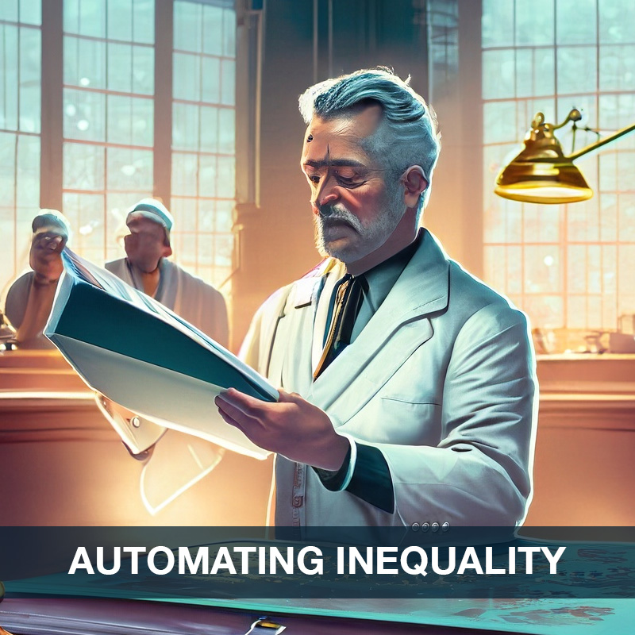

<!-- wp:cover {"url":"./images/applied-data-ethics/irishguy_a_mathematician_and_psychologist_nvents_psychohistory__b2e4dea9-e297-4c8e-8607-a864572b1a8f.png","id":2944,"dimRatio":50,"align":"full"} -->

<!-- wp:paragraph {"align":"center","placeholder":"Write title…","fontSize":"large"} -->

Intersection of Technology and Social Justice

<!-- /wp:paragraph -->

<!-- /wp:cover -->

<!-- wp:paragraph -->

As a Designer, Senior Web Developer &amp; SEO Specialist, I find it crucial to stay up-to-date on the latest developments in data ethics. Completing the <strong>University of San Francisco Data Institute's course on Applied Data Ethics</strong> is part of my journey. 

<!-- /wp:paragraph -->

<!-- wp:paragraph -->

While none of this information is new. The Applied Data Ethics course did reinforce my awareness of the ethical considerations in data-focused work. The curriculum and lectures showcased (<em>again</em>) how ethical principles plays out in real-world scenarios.  

<!-- /wp:paragraph -->

<!-- wp:group {"align":"wide","style":{"color":{"background":"#e7e9e6"}},"layout":{"type":"constrained"}} -->

<!-- wp:paragraph -->

The <strong>Applied Data Ethics</strong> course overlaps with several recent books that I have reviewed, including "<em>Design Justice</em>" by Sasha Costanza-Chock, "<em>Automating Inequality</em>" by Virginia Eubanks and "<em>Race after Technology</em>" by Ruha Benjamin. These books discuss the ways in which technology can perpetuate and exacerbate systemic inequalities. The Applied Data Ethics course similarly emphasizes the need for ethical considerations in technology and data-related work. While exploring the principles of community-led design and its potential to create a more just and equitable society.

<!-- /wp:paragraph -->

<!-- wp:columns {"align":"wide","style":{"elements":{"link":{"color":{"text":"var:preset|color|foreground"}}}}} -->

<!-- wp:column -->

<!-- wp:image {"align":"center","id":2802,"sizeSlug":"full","linkDestination":"custom"} -->

<figure class="wp-block-image aligncenter size-full"><figcaption class="wp-element-caption"><a href="https://betterworldwithdesign.com/design-justice-community-led-practices-to-build-the-worlds-we-need/" data-type="post" data-id="2524">Design Justice</a></figcaption></figure>

<!-- /wp:image -->

<!-- /wp:column -->

<!-- wp:column -->

<!-- wp:image {"align":"center","id":3728,"sizeSlug":"full","linkDestination":"custom"} -->

<figure class="wp-block-image aligncenter size-full"><figcaption class="wp-element-caption"><a href="https://betterworldwithdesign.com/automating-inequality-how-high-tech-tools-profile-police-and-punish-the-poor/" data-type="post" data-id="3724">Automating Inequality</a></figcaption></figure>

<!-- /wp:image -->

<!-- /wp:column -->

<!-- wp:column -->

<!-- wp:image {"align":"center","id":4204,"sizeSlug":"full","linkDestination":"custom"} -->

<figure class="wp-block-image aligncenter size-full"><figcaption class="wp-element-caption"><a href="https://betterworldwithdesign.com/race-after-technology-abolitionist-tools-for-the-new-jim-code/" data-type="post" data-id="2627">Race After Technology</a></figcaption></figure>

<!-- /wp:image -->

<!-- /wp:column -->

<!-- /wp:columns -->

<!-- /wp:group -->

<!-- wp:separator {"className":"is-style-wide"} -->

<!-- /wp:separator -->

<!-- wp:paragraph -->

<strong>The course covered a broad range of topics</strong> (I am working on blogs for each topic). 

<!-- /wp:paragraph -->

<!-- wp:list -->

<ul><!-- wp:list-item -->

<li><a href="https://betterworldwithdesign.com/combating-disinformation-strategies-and-solutions/" data-type="post" data-id="4392">Disinformation</a> </li>

<!-- /wp:list-item -->

<!-- wp:list-item -->

<li>Bias &amp; Fairness </li>

<!-- /wp:list-item -->

<!-- wp:list-item -->

<li>Ethical Foundations </li>

<!-- /wp:list-item -->

<!-- wp:list-item -->

<li>Practical Tools</li>

<!-- /wp:list-item -->

<!-- wp:list-item -->

<li>Privacy &amp; Surveillance </li>

<!-- /wp:list-item -->

<!-- wp:list-item -->

<li>The Silicon Valley ecosystem</li>

<!-- /wp:list-item -->

<!-- wp:list-item -->

<li>Algorithmic Colonialism </li>

<!-- /wp:list-item --></ul>

<!-- /wp:list -->

<!-- wp:group {"align":"wide","style":{"color":{"background":"#c7e5f7"}},"layout":{"type":"constrained"}} -->

<!-- wp:paragraph -->

The <strong>Applied Data Ethics</strong> course also aligns with the Center for Humane Technology Certification, which encourages ethical design practices and promotes technology that benefits humanity.

<!-- /wp:paragraph -->

<!-- wp:columns {"align":"wide"} -->

<!-- wp:column -->

<!-- wp:embed {"url":"https://youtu.be/xoVJKj8lcNQ","type":"video","providerNameSlug":"youtube","responsive":true,"className":"wp-embed-aspect-16-9 wp-has-aspect-ratio"} -->

<figure class="wp-block-embed is-type-video is-provider-youtube wp-block-embed-youtube wp-embed-aspect-16-9 wp-has-aspect-ratio">

<iframe loading="lazy" title="The A.I. Dilemma - March 9, 2023" width="1080" height="608" src="https://www.youtube.com/embed/xoVJKj8lcNQ?feature=oembed" frameborder="0" allow="accelerometer; autoplay; clipboard-write; encrypted-media; gyroscope; picture-in-picture; web-share" allowfullscreen></iframe>

<figcaption class="wp-element-caption">The A.I. Dilemma - March 9, 2023 (Part 1)</figcaption></figure>

<!-- /wp:embed -->

<!-- /wp:column -->

<!-- wp:column -->

<!-- wp:embed {"url":"https://www.youtube.com/watch?v=yuLfdhrGX6k","type":"video","providerNameSlug":"youtube","responsive":true,"className":"wp-embed-aspect-16-9 wp-has-aspect-ratio"} -->

<figure class="wp-block-embed is-type-video is-provider-youtube wp-block-embed-youtube wp-embed-aspect-16-9 wp-has-aspect-ratio">

<iframe loading="lazy" title="AI Town Hall -- Center for Humane Technology" width="1080" height="608" src="https://www.youtube.com/embed/yuLfdhrGX6k?feature=oembed" frameborder="0" allow="accelerometer; autoplay; clipboard-write; encrypted-media; gyroscope; picture-in-picture; web-share" allowfullscreen></iframe>

<figcaption class="wp-element-caption">A.I. Town Hall - June 9, 2023 (Part 2)</figcaption></figure>

<!-- /wp:embed -->

<!-- /wp:column -->

<!-- /wp:columns -->

<!-- wp:columns -->

<!-- wp:column -->

<!-- /wp:column -->

<!-- wp:column -->

<!-- wp:image {"id":4427,"sizeSlug":"full","linkDestination":"custom"} -->

<figure class="wp-block-image size-full"><figcaption class="wp-element-caption"><a rel="noreferrer noopener" href="https://www.irishguydesign.studio/awards-certificates/" data-type="URL" data-id="https://www.irishguydesign.studio/awards-certificates/" target="_blank">Certificate of Completion</a></figcaption></figure>

<!-- /wp:image -->

<!-- /wp:column -->

<!-- wp:column -->

<!-- /wp:column -->

<!-- /wp:columns -->

<!-- /wp:group -->

<!-- wp:heading -->

<h2 class="wp-block-heading">Recommended Reading</h2>

<!-- /wp:heading -->

<!-- wp:list -->

<ul><!-- wp:list-item -->

<li>Will Oremus, <a href="https://onezero.medium.com/the-simplest-way-to-spot-coronavirus-misinformation-on-social-media-4b7995448071">The Simplest Way to Spot Coronavirus Misinformation on Social Media</a></li>

<!-- /wp:list-item -->

<!-- wp:list-item -->

<li>Guillaume Chaslot, <a href="https://medium.com/@guillaumechaslot/how-algorithms-can-learn-to-discredit-the-media-d1360157c4fa">How Algorithms Can Learn to Discredit the Media</a></li>

<!-- /wp:list-item -->

<!-- wp:list-item -->

<li>Rachelle Hampton, <a href="https://slate.com/technology/2019/04/black-feminists-alt-right-twitter-gamergate.html">The Black Feminists Who Saw the Alt-Right Threat Coming</a></li>

<!-- /wp:list-item -->

<!-- wp:list-item -->

<li>Renee DiResta, <a href="https://www.ribbonfarm.com/2019/12/17/mediating-consent/">Mediating Consent</a></li>

<!-- /wp:list-item -->

<!-- wp:list-item -->

<li>Manuel Velasquez et al, <a href="https://www.scu.edu/ethics/ethics-resources/ethical-decision-making/what-is-ethics/">“What is ethics?”</a></li>

<!-- /wp:list-item -->

<!-- wp:list-item -->

<li>Arvind Narayan, <a href="https://www.youtube.com/watch?v=jIXIuYdnyyk">21 Definitions of Fairness</a></li>

<!-- /wp:list-item -->

<!-- wp:list-item -->

<li>Timnit Gebru et al, <a href="https://arxiv.org/abs/1803.09010">Datasheets for Datasets</a></li>

<!-- /wp:list-item -->

<!-- wp:list-item -->

<li>Harini Suresh and John Guttag, <a href="https://arxiv.org/abs/1901.10002">A Framework for Understanding Unintended Consequences of Machine Learning</a></li>

<!-- /wp:list-item -->

<!-- wp:list-item -->

<li>Samir Passi and Solon Barocas, <a href="https://arxiv.org/abs/1901.02547">Problem Formulation and Fairness</a></li>

<!-- /wp:list-item -->

<!-- wp:list-item -->

<li>Jennifer Valentino-DeVries et al (NYT), <a href="https://www.nytimes.com/interactive/2018/12/10/business/location-data-privacy-apps.html">Your Apps Know Where You Were Last Night, and They’re Not Keeping It Secret</a></li>

<!-- /wp:list-item -->

<!-- wp:list-item -->

<li>Phillip Rogaway, <a href="https://web.cs.ucdavis.edu/~rogaway/papers/moral-fn.pdf">The Moral Character of Cryptographic Work</a></li>

<!-- /wp:list-item -->

<!-- wp:list-item -->

<li>Alvaro Bedoya, <a href="https://papers.ssrn.com/sol3/papers.cfm?abstract_id=3599201">Privacy as a Civil Right</a></li>

<!-- /wp:list-item -->

<!-- wp:list-item -->

<li>Chris Gilliard, <a href="https://urbanomnibus.net/2020/01/caught-in-the-spotlight/">Caught in the Spotlight</a></li>

<!-- /wp:list-item -->

<!-- wp:list-item -->

<li>Abeba Birhane, <a href="https://reallifemag.com/the-algorithmic-colonization-of-africa/">The Algorithmic Colonization of Africa</a></li>

<!-- /wp:list-item -->

<!-- wp:list-item -->

<li>Amy Maxmen (Nature), <a href="https://www.nature.com/articles/d41586-019-01679-5">Can tracking people through phone-call data improve lives?</a></li>

<!-- /wp:list-item -->

<!-- wp:list-item -->

<li>Adrienne Lafrance, <a href="https://www.theatlantic.com/technology/archive/2016/02/facebook-and-the-new-colonialism/462393/">Facebook and the New Colonialism</a></li>

<!-- /wp:list-item --></ul>

<!-- /wp:list -->

<!-- wp:group {"style":{"border":{"width":"1px"}},"backgroundColor":"background","layout":{"type":"constrained"}} -->

<!-- wp:paragraph {"style":{"typography":{"fontSize":"1.3rem"}},"fontFamily":"system-font"} -->

<strong>Applied Data Ethics, is essential for all working in tech</strong>

<!-- /wp:paragraph -->

<!-- wp:paragraph {"style":{"color":{"text":"#8c8f94"},"typography":{"fontSize":"14px"}},"fontFamily":"system-font"} -->

University of San Francisco Data Institute covering disinformation, bias &amp; fairness, ethical foundations, practical tools, privacy &amp; surveillance, the silicon valley ecosystem, and algorithmic colonialism.

<!-- /wp:paragraph -->

<!-- wp:paragraph {"style":{"typography":{"fontSize":"0.85rem"}}} -->

<a href="https://www.fast.ai/posts/2020-08-19-data-ethics.html">Applied Data-Ethics Syllabus</a>

<!-- /wp:paragraph -->

<!-- /wp:group -->

