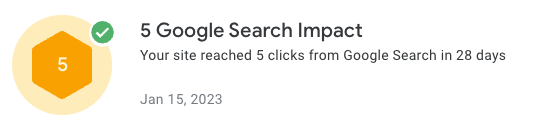
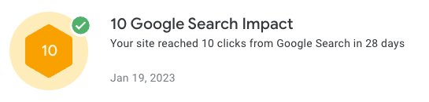
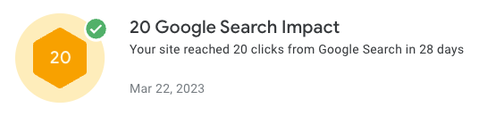
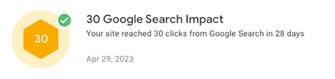
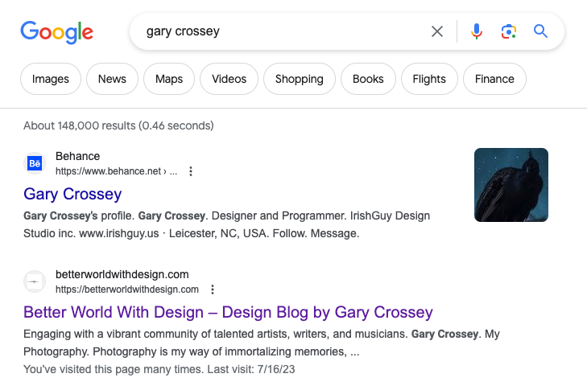
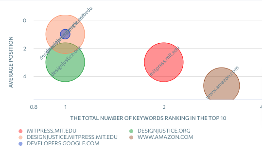
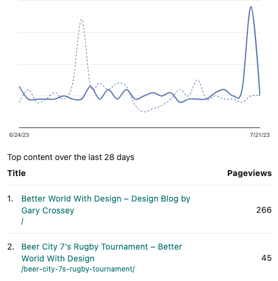

<figure class="wp-block-image size-full"></figure>

Generating website traffic is a long-term process that requires dedication and hard work. It involves the perfect blend of tactics like SEO, social media promotion, content writing and more to get the desired results. Though it may take some time for the results to show. You could see increased traction to your website with weeks or even months of using them.

Website engagement can be tracked in a number of ways, particularly with metrics such as page views, session duration, bounce rate and conversion rate. This is an effective way to measure the success of both content and promotion on your website. Tracking your metrics before &amp;amp; after making changes to your content or strategies enables you to measure the success of what you've tried. This way, you can understand the impact of your decisions and refine them accordingly.

If your content was successful, you'll be able to tell. Take a look at metrics such as page views and session duration on your website, it could signal that your blog post or social media promotion really resonated with the audience, and kept them engaged! It's really great to see a decrease in bounce rate when you optimize your website for SEO. This can be an indication that your website is now more discoverable and super relevant to users.

Tracking the amount of traffic generated by a website is crucial for evaluating its performance. <a href="https://betterworldwithdesign.com/">Betterworldwithdesign.com</a> is no exception.

<h2 class="wp-block-heading">Benchmarks and Metrics</h2>

<h3 class="wp-block-heading">2023 Q1: January, February, and March</h3>

<figure class="wp-block-image size-full"></figure>

<figure class="wp-block-image size-full"></figure>

<figure class="wp-block-image size-full"></figure>

<h3 class="wp-block-heading">2023 Q2: April, May, and June</h3>

<figure class="wp-block-image size-full"></figure>

<h3 class="wp-block-heading">2023 3. Q3: July, August, and September</h3>

<figure class="wp-block-image size-full"></figure>

<figure class="wp-block-table"><table><thead><tr><th>Keywords</th><th>Vol.</th><th>Competition</th><th>Results</th><th>Jul-20</th><th>Jul-21</th></tr></thead><tbody><tr><td>Gary Crossey</td><td>10</td><td>0</td><td>129K</td><td>2</td><td>2</td></tr><tr><td>Better world with design</td><td>0</td><td>0</td><td>5B</td><td>6</td><td>7</td></tr><tr><td>Design Justice</td><td>880</td><td>0.8</td><td>783M</td><td></td><td>46</td></tr></tbody></table><figcaption class="wp-element-caption">Ranking Keywords</figcaption></figure>

<h3 class="wp-block-heading">Distribution of competitors </h3>

The distribution of competitors in organic search results based on the number of keywords they rank for, the average position of these keywords, and the Search Visibility of the site.

<figure class="wp-block-image size-full"></figure>

The BWWD website has made some progress by accumulating over 100 articles focused on art, design, and tech, which happen to be your core interests. This demonstrates a commitment to providing a wealth of valuable content in these specific areas. In addition to catering to niche interests, it's worth noting that the website's focus on art, design, and tech can also be a strategic move from an SEO (Search Engine Optimization) perspective. By concentrating on a specific subject matter, the website can establish itself as an authoritative source in these fields, potentially driving targeted organic traffic and improving its search engine rankings. 

<strong>QUESTION - Is targeting art, design, and tech to board a scope for to be an effective SEO strategy? </strong> 

You're correct that art, design, and tech are broad subjects that may have a higher level of competition when it comes to ranking in search engines. However, it's important to consider that while these topics individually may have a wide range of content available online, the combination of art, design, and tech can create a unique and niche focus for the BWWD website.

By providing a specialized platform that covers all three areas, the website can attract a specific audience interested in the intersection of art, design, and technology. This targeted approach can help the website stand out among broader competitors, potentially leading to a more engaged and loyal audience.

To improve SEO rankings, the website can also focus on producing high-quality, unique, and informative content that addresses specific aspects or trends within art, design, and tech. Implementing proper keyword research, optimizing meta tags, and building relevant backlinks can also contribute to its visibility in search engine results pages.

<h2 class="wp-block-heading">Posting New Content </h2>

One of the advantages of having a new or low-traffic website is the ability to quickly analyze user responses and determine what attracts them to your site. And, that is certainly true for this website. Preliminary findings indicate a significant spike in traffic following the publication of the rugby photography collection. Furthermore, user engagement metrics, such as time spent on the website and click-through rates, exhibited positive trends. This particular post has generated a spike in traffic, surpassing even the previous peak we experienced with our prior rugby collection. The recent rugby photography post received 45 new views within the first day. In comparison, our other content typically receives a smaller increase in traffic, ranging from 4 to 10 new views on the first day.

<a href="https://betterworldwithdesign.com/beer-city-7s-rugby-tournament/" data-type="post" data-id="4454">Beer City 7's Rugby Tournament</a>

<figure class="wp-block-image size-full"><figcaption class="wp-element-caption">Spike in traffic.</figcaption></figure>

<h3 class="wp-block-heading">2023 4Q4: October, November, and December</h3>

<h3 class="wp-block-heading">Clicks from Searches</h3>

From January to April, we observed an increase in the number of clicks originating from search engines, indicating improved visibility and traffic to the website. This improvement can be attributed to Google effectively indexing and ranking the website, resulting in increased visibility and higher placement in search engine results.

