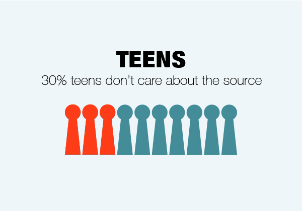
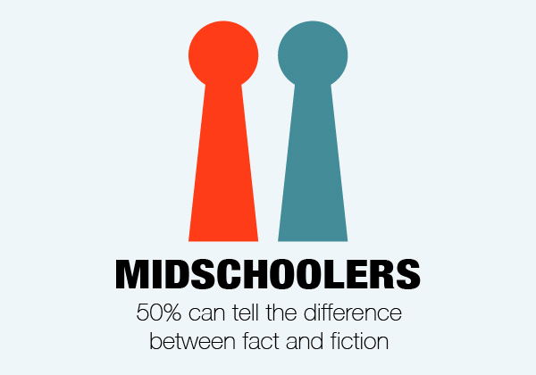
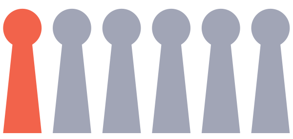
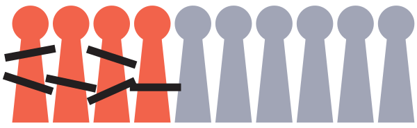
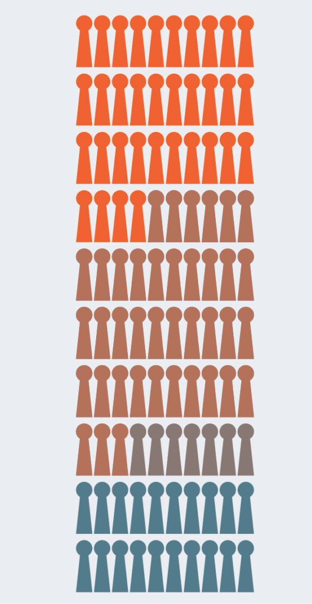

<h2 class="wp-block-heading has-text-align-center">Infographics on the  effects of digital media on their lives. </h2>

<figure class="wp-block-pullquote has-tertiary-background-color has-background has-link-color has-small-font-size wp-elements-5"><blockquote>
I have chosen <strong><a rel="noreferrer noopener" href="https://ledger.humanetech.com/" target="_blank">Ledger of Harms</a></strong> as my source for my infographics because it is a reliable and authoritative source of information about the use of devices. The Ledger of Harms is a database that contains the harms that people suffer when they use digital media. Ledger of Harms is a joint project between the University of Pittsburgh and Carnegie Mellon University. The online database helps people understand the effects of digital media in their lives. The data provides information about how digital media affects our brains, attention spans, sleep patterns, and relationships with others.
<cite>Gary Crossey</cite></blockquote></figure>

The Ledger of Harms database has more than 200 harms, with an average of five new ones being added every month.

Social Media = Misinformation. 

<figure class="wp-block-image aligncenter size-full"></figure>

Private Study: <a href="https://www.commonsensemedia.org/research/teens-and-the-news-the-influencers-celebrities-and-platforms-they-say-matter-most-2020" target="_blank" rel="noreferrer noopener">Robb, M. B., 2020. Common Sense Media</a>

<figure class="wp-block-image aligncenter size-full"></figure>

The Next Generation (Ledger of Harms) addresses the impact of social media with children. I also see the same happening in my rural community. At the farmers market the conversations are often connected with Instagram, Tik Tok, and Facebook. 

<h2 class="wp-block-heading has-text-align-center">Infographics on the  effects of digital media on their lives.</h2>

<figure class="wp-block-image aligncenter size-large is-resized"></figure>

<h3 class="wp-block-heading has-text-align-center">1 in 3 Teen Girls</h3>

Asked to share nudes

<a rel="noreferrer noopener" href="https://www.thorn.org/resources-and-research/" data-type="URL" data-id="https://www.thorn.org/resources-and-research/" target="_blank">2021 Thorn Impact Report</a>

<figure class="wp-block-image aligncenter size-large is-resized"></figure>

<h3 class="wp-block-heading has-text-align-center">1 in 6 Girls 9-12</h3>

Have had sexual interaction with an adult online.

<a rel="noreferrer noopener" href="https://www.thorn.org/resources-and-research/" data-type="URL" data-id="https://www.thorn.org/resources-and-research/" target="_blank">2021 Thorn Impact Report</a>

<figure class="wp-block-image aligncenter size-large is-resized"></figure>

<h3 class="wp-block-heading has-text-align-center">Youth 13-17</h3>

More than 40% of youth between 13-17 reported that it is "normal for people my age to share nudes with each other"

<a rel="noreferrer noopener" href="https://www.thorn.org/resources-and-research/" data-type="URL" data-id="https://www.thorn.org/resources-and-research/" target="_blank">2021 Thorn Impact Report</a>

The Ledger of Harms database has more than 200 harms, with an average of five new ones being added every month.

<h4 class="wp-block-heading has-text-align-center">What content teens are sharing? </h4>

According to the 2021 Thorn Report Teens claimed that they shared content with someone who they believed was 18 or older. 

<ul class="wp-block-list">
<li>34% of teens said they shared a nude photo or video of another kid</li>

<li>73% of teens actually shared a nude photo or video of another kid </li>

<li>80% of those teens has shared a nude photo or video of themselves </li>
</ul>

<figure class="wp-block-image aligncenter size-full"></figure>

<h2 class="wp-block-heading">Traits of Addiction</h2>

The teens involved in the report had less than 50% accuracy when reporting how many nudes of other people they had shared, compared to the actual amount they had shared. 

Similarly, 50% of Middle Schoolers are unable to tell the difference between fact and fiction. 

For me this report, is aligning the traits of addiction - moving away from the external to the internal impact.  

<ul class="wp-block-list">
<li>Can tell the difference between fact and fiction </li>

<li>Deflates the times actions is performed  </li>

<li>Decreased accountability </li>

<li>Lack of recall for the distribution of content</li>
</ul>

<strong>The Impact of Technology Series</strong>

<nav style="font-style:normal;font-weight:400;line-height:0" class="has-background has-tertiary-background-color has-small-font-size items-justified-right is-vertical no-wrap sm-nav wp-block-navigation is-content-justification-right is-nowrap is-layout-flex wp-container-core-navigation-is-layout-0d799182 wp-block-navigation-is-layout-flex" aria-label="Tech Blog"><ul style="font-style:normal;font-weight:400;line-height:0" class="wp-block-navigation__container has-background has-tertiary-background-color has-small-font-size items-justified-right is-vertical no-wrap sm-nav wp-block-navigation"><li class="wp-block-navigation-item wp-block-navigation-link"><a class="wp-block-navigation-item__content"  href="https://betterworldwithdesign.com/the-impact-of-technology-on-child-development/">The impact of technology on child development</a></li><li class="wp-block-navigation-item wp-block-navigation-link"><a class="wp-block-navigation-item__content"  href="https://betterworldwithdesign.com/content-on-the-internet/">Content on the Internet</a></li></ul></nav>

