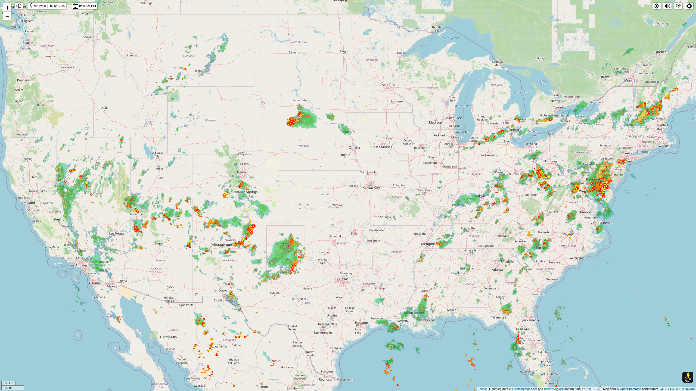

<h2 class="has-large-font-size wp-block-heading"><a href="http://lightningmaps.org/">LightningMaps.org</a>:  Real Time Lightning Map</h2>

<!--more-->

<figure class="wp-block-image size-large"></figure>

<a href="http://lightningmaps.org/">LightningMaps.org</a> is a real-time lightning map that allows users to track lightning strikes across the globe. This online tool uses data provided by the Blitzortung network, a global lightning detection network, and displays it on an interactive map.

The <a href="http://lightningmaps.org/">LightningMaps.org</a> interface is user-friendly and easy to navigate. The map displays lightning strikes in real-time, allowing users to track the location, frequency, and intensity of lightning strikes in their area. The map can be zoomed in or out to display lightning strikes at different scales.

In addition to real-time lightning tracking, <a href="http://lightningmaps.org/">LightningMaps.org</a> also provides users with historical lightning data. Users can view lightning data from the past 24 hours, week, or month. For those interested in weather patterns and trends, <a href="http://lightningmaps.org/">LightningMaps.org</a> offers a historical data archive that dates back to 2011.

<a href="http://lightningmaps.org/">LightningMaps.org</a> is a valuable tool for individuals, businesses, and organizations that rely on weather information. Farmers, outdoor enthusiasts, and event planners can use the tool to monitor weather patterns and make informed decisions. Emergency responders can also use the tool to track lightning strikes and respond to emergencies in a timely manner.

In conclusion, <a href="http://lightningmaps.org/">LightningMaps.org</a> is a highly useful tool for anyone seeking real-time and historical lightning data. It is a great resource for individuals, businesses, and organizations that need accurate weather information at their fingertips.

Link to <a href="https://lmaps.org/#-75.04;36.8;5" target="_blank" rel="noreferrer noopener">Real Time Lighting Map</a>.

