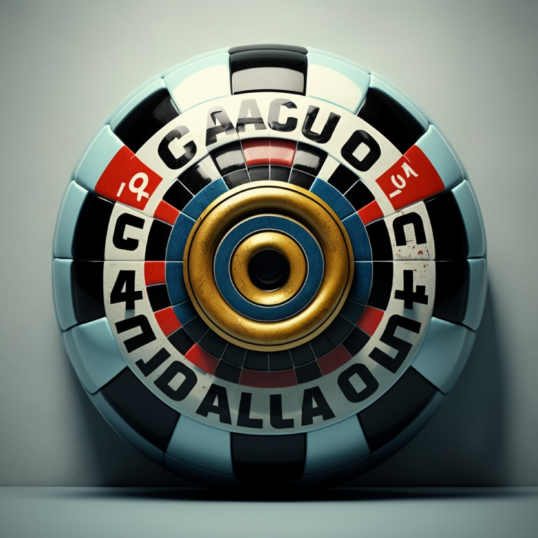

<h2 class="wp-block-heading has-text-align-center">Password Mantra:  How I Reach My Goals</h2>

<figure class="wp-block-image size-large"><figcaption class="wp-element-caption">AI Digital Art by Gary Crossey</figcaption></figure>

Passwords are a crucial aspect of our daily lives as we use them to access our accounts, devices, and essential information. But did you know that you could also use passwords to help you reach your goals? It's true; creating a password mantra is a simple yet powerful technique that can help you stay motivated and on track.

A password mantra is a phrase or word that you use as a password, which reminds you of your goal every time you type it. This method is not only useful for keeping your accounts secure but can also help you stay focused on your aspirations.

I have used this technique to create a password mantra that reflects my financial goal of saving more in 2023. My password mantra, $<strong>aveMorein2023</strong>, reminds me of my commitment to this goal every time I type it. This, in turn, motivates me to take the necessary steps to achieve my financial objective.

In addition to being a helpful reminder, password mantras can also make it easier to remember passwords. Using a phrase or word that is meaningful to you can help you recall your password more easily, reducing the need to reset it frequently. So, consider creating a password mantra for your next password and see how it can help you stay motivated and secure.

<figure class="wp-block-image aligncenter size-full"><figcaption class="wp-element-caption">AI Digital Art by Gary Crossey</figcaption></figure>

Use special characters whenever possible in passwords, and include your goal dates or the date you set the goal. Make the numbers meaningful to you and your goal outcome.

<strong>! @ # $ % ^ &amp; * ( ) _ + - = ' " : ; ' ? ` ~</strong>

But my experience isn't limited to financial goals alone. I have applied this technique to other areas of my life, such as fitness, cooking, travel, for anything really. 

For example, when I wanted to develop a daily exercise routine, I created a password mantra that reflected my fitness goal - <strong>Workout4DaysAWeek</strong>. This password not only kept my account secure but also reminded me to think about staying fit and healthy. In this example, I actually set an unrealistic goal, I have zero personal fitness interest. <strong>DOC_Ument=AI~REsult=23</strong> (now that's a password I can get behind). 

By creating a password mantra that reflects your objectives, you can keep these goals at the forefront of your mind and take the necessary steps to achieve them.

<figure class="wp-block-image size-full"><figcaption class="wp-element-caption">AI Digital Art by Gary Crossey</figcaption></figure>

<h2 class="wp-block-heading">Password Ideas </h2>

To make the password more secure, think about where you can add <strong>special characters</strong> (@#$%^&amp;*:"+=-_,~`) with a mix or <strong>UPPER</strong> and <strong>Lower Case</strong>, with a <strong>Dash</strong>  -- or <strong>Underline</strong> __. 

<h2 class="wp-block-heading has-pale-pink-color has-foreground-background-color has-text-color has-background">DO NOT include personal information in your password</h2>

<ul class="wp-block-list">
<li>No Names (including pet names) </li>

<li>No Addresses </li>

<li>No birthdays or anniversary  (unless you need to reminder the Anniversary - <strong>MARCH-iS~TIME</strong> avoid using precise personal information). </li>

<li>Avoid using common  dictionary words or phrases (PushYourselfToNewLimits)</li>
</ul>

<h3 class="wp-block-heading">Inspirational Password Ideas</h3>

While I wouldn't use most of these examples for myself, simply cause they don't relate to me. Your Password Mantra only works if it relates to you. Use these ideas as your starting point. Connect your personal goal with your password. 

<ul class="wp-block-list">
<li>$uccessIs[MyOnlyOption]</li>

<li>BeTheChangeYouWantToSee</li>

<li>Chase_YourDreams2024</li>

<li>CreateYour-OwnDestiny</li>

<li>FocusOnTheFutureNow</li>

<li>GoalGetter2024</li>

<li>HustleHarder=2024</li>

<li>WORKEqual$Success-24~7</li>

<li>PositiveVibesOnly2020</li>

<li>Rise&amp;Grind-2024</li>

<li>#StayFocusedAndMotivated</li>

<li>ThinkBig_AchieveBIGGER</li>

<li>Unlock-Potential2024</li>
</ul>

<h3 class="wp-block-heading">Will creating a password help me reach my goal? </h3>

Aligning your Personal Password Goal with your password practice has absolutely no evidence to show any success yet. However, what it can certainly do is remind you of your failures. 

If you set your password goal - <strong>$AVE4-trip2_Eire2022 </strong>

And, in 2023 you haven't gone to Ireland you are reminded of your personal failure every time you use the password. To be truthful, I have passwords of goals going back ten years that I haven't reached, I also haven't forgotten them, and am reminded every time I have to login to that old GoDaddy account.  

<h3 class="wp-block-heading">Travel Password Ideas</h3>

<ul class="wp-block-list">
<li>T#ravel_Th3_World!</li>

<li>S3e_Th3_World#</li>

<li><em>Adventur3_Awaits</em></li>

<li>Ex#plor3_New_Plac3s</li>

<li>J0urn3y_To_New_H3ights</li>
</ul>

<h3 class="wp-block-heading">Food Password Ideas </h3>

<ul class="wp-block-list">
<li>Cook_4_L0ve_And_Joy!</li>

<li>Bak3_M0r3_L0v3#</li>

<li><em>F00d_Is_Lif3</em></li>

<li>Spic3_Up_Your_Lif3!</li>

<li>Sav0ry_&amp;_Sati$fying</li>
</ul>

Start today and make your password useful (and not personal). 

Good Luck with reaching your goals.  Avoid using the same password for different accounts. Update your passwords regularly to reflect your new goals. 

