<figure class="wp-block-image size-full"></figure>

<h3 class="wp-block-heading">I love this free Goodreads widget! </h3>

What did I do before Goodreads? 

Goodreads is one of my favorite websites to use. This really cool widget for displaying the books I have read by year (as long as I have used Goodreads) are displayed. Personally, I like that I can quickly scan this one post for that book title I couldn't quite recall but want to share. 

Let me know how you keep track of your reading habits. 

2020

      

        <!-- Show static html as a placeholder in case js is not enabled - javascript include will override this if things work -->
            <h2>
      <a style="text-decoration: none;" rel="nofollow" href="https://www.goodreads.com/review/list/54140412-gary-crossey?shelf=2020&amp;utm_medium=api&amp;utm_source=grid_widget">Gary's 2020 book montage</a>
    </h2>
  

    
<a title="Ulysses" rel="nofollow" href="https://www.goodreads.com/book/show/338798.Ulysses">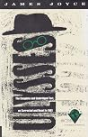</a>

    

    
<a title="Photographs by Man Ray: 105 Works, 1920-1934" rel="nofollow" href="https://www.goodreads.com/book/show/221150.Photographs_by_Man_Ray">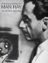</a>

    

    

    

    
<a title="Recursion" rel="nofollow" href="https://www.goodreads.com/book/show/42046112-recursion">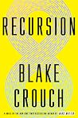</a>

    
<a title="A Spot of Bother" rel="nofollow" href="https://www.goodreads.com/book/show/4701.A_Spot_of_Bother">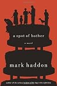</a>

    
<a title="The Snow Child" rel="nofollow" href="https://www.goodreads.com/book/show/33597976-the-snow-child">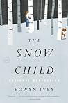</a>

    
<a title="Range: Why Generalists Triumph in a Specialized World" rel="nofollow" href="https://www.goodreads.com/book/show/41795733-range">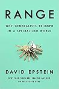</a>

    

    

    

    

    

    
<a title="Homegoing" rel="nofollow" href="https://www.goodreads.com/book/show/27071490-homegoing">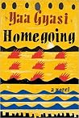</a>

    
<a title="The Book Woman of Troublesome Creek" rel="nofollow" href="https://www.goodreads.com/book/show/40914165-the-book-woman-of-troublesome-creek">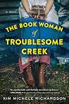</a>

    
<a title="Let's Pretend This Never Happened: A Mostly True Memoir" rel="nofollow" href="https://www.goodreads.com/book/show/12868761-let-s-pretend-this-never-happened">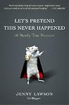</a>

    
<a title="Tubes: A Journey to the Center of the Internet" rel="nofollow" href="https://www.goodreads.com/book/show/13036199-tubes">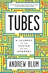</a>

    

      <a class="gr_grid_branding" style="font-size: .9em; color: #382110; text-decoration: none; float: right; clear: both" rel="nofollow" href="https://www.goodreads.com/user/show/54140412-gary-crossey">Gary Crossey's favorite books »</a>
  <noscript> Share <a rel="nofollow" href="/">book reviews</a> and ratings with Gary, and even join a <a rel="nofollow" href="/group">book club</a> on Goodreads.</noscript>
  

      

      

      

        <!-- Show static html as a placeholder in case js is not enabled - javascript include will override this if things work -->
            <h2>
      <a style="text-decoration: none;" rel="nofollow" href="https://www.goodreads.com/review/list/54140412-gary-crossey?shelf=2021&amp;utm_medium=api&amp;utm_source=grid_widget">Gary's 2021 book montage</a>
    </h2>
  

    
<a title="Super Graphic: A Visual Guide to the Comic Book Universe" rel="nofollow" href="https://www.goodreads.com/book/show/17220622-super-graphic">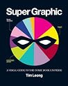</a>

    

    
<a title="Normal People" rel="nofollow" href="https://www.goodreads.com/book/show/41057294-normal-people">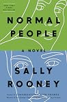</a>

    

    

    

    
<a title="Heartstopper: Volume Two (Heartstopper, #2)" rel="nofollow" href="https://www.goodreads.com/book/show/43307358-heartstopper">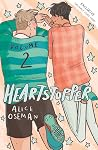</a>

    

    

    
<a title="Lovecraft Country (Lovecraft Country, #1)" rel="nofollow" href="https://www.goodreads.com/book/show/25109947-lovecraft-country">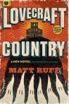</a>

    
<a title="Henri Cartier-Bresson: The Man, the Image and the World: A Retrospective" rel="nofollow" href="https://www.goodreads.com/book/show/72330.Henri_Cartier_Bresson">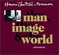</a>

    

    
<a title="A Keeper" rel="nofollow" href="https://www.goodreads.com/book/show/43723660-a-keeper">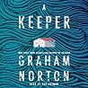</a>

    

    
<a title="Engaged Observers: Documentary Photography Since the Sixties" rel="nofollow" href="https://www.goodreads.com/book/show/8545919-engaged-observers">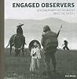</a>

    

    

    
<a title="What Matters: The World's Preeminent Photojournalists and Thinkers Depict Essential Issues of Our Time" rel="nofollow" href="https://www.goodreads.com/book/show/4447548-what-matters">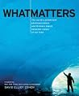</a>

    

    
<a title="Go Tell It to the Mountain" rel="nofollow" href="https://www.goodreads.com/book/show/32491350-go-tell-it-to-the-mountain">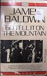</a>

      <a class="gr_grid_branding" style="font-size: .9em; color: #382110; text-decoration: none; float: right; clear: both" rel="nofollow" href="https://www.goodreads.com/user/show/54140412-gary-crossey">Gary Crossey's favorite books »</a>
  <noscript> Share <a rel="nofollow" href="/">book reviews</a> and ratings with Gary, and even join a <a rel="nofollow" href="/group">book club</a> on Goodreads.</noscript>
  

      

      

      

        <!-- Show static html as a placeholder in case js is not enabled - javascript include will override this if things work -->
            <h2>
      <a style="text-decoration: none;" rel="nofollow" href="https://www.goodreads.com/review/list/54140412-gary-crossey?shelf=2022&amp;utm_medium=api&amp;utm_source=grid_widget">Gary's 2022 book montage</a>
    </h2>
  

    

    

    

    

    
<a title="Deep Work: Rules for Focused Success in a Distracted World" rel="nofollow" href="https://www.goodreads.com/book/show/25744928-deep-work">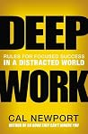</a>

    
<a title="1000 Years of Joys and Sorrows: A Memoir" rel="nofollow" href="https://www.goodreads.com/book/show/57423429-1000-years-of-joys-and-sorrows">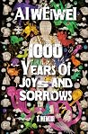</a>

    
<a title="Imogen: The Mother of Modernism and Three Boys" rel="nofollow" href="https://www.goodreads.com/book/show/15805165-imogen">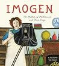</a>

    
<a title="This Is Your Mind on Plants" rel="nofollow" href="https://www.goodreads.com/book/show/56015023-this-is-your-mind-on-plants">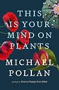</a>

    
<a title="How to Change Your Mind: What the New Science of Psychedelics Teaches Us About Consciousness, Dying, Addiction, Depression, and Transcendence" rel="nofollow" href="https://www.goodreads.com/book/show/36613747-how-to-change-your-mind">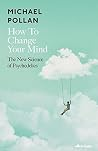</a>

    
<a title="In Defense of Food: An Eater's Manifesto" rel="nofollow" href="https://www.goodreads.com/book/show/315425.In_Defense_of_Food">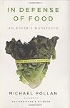</a>

    
<a title="My Brother's Husband, Volume 2 (Otouto no Otto, #3-4)" rel="nofollow" href="https://www.goodreads.com/book/show/37824476-my-brother-s-husband-volume-2">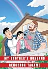</a>

    

    

    

    

    
<a title="In Real Life: Six Women Photographers" rel="nofollow" href="https://www.goodreads.com/book/show/672455.In_Real_Life">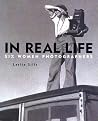</a>

    

    
<a title="The Hard Thing About Hard Things: Building a Business When There Are No Easy Answers" rel="nofollow" href="https://www.goodreads.com/book/show/18176747-the-hard-thing-about-hard-things">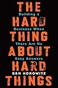</a>

    

    

      <a class="gr_grid_branding" style="font-size: .9em; color: #382110; text-decoration: none; float: right; clear: both" rel="nofollow" href="https://www.goodreads.com/user/show/54140412-gary-crossey">Gary Crossey's favorite books »</a>
  <noscript> Share <a rel="nofollow" href="/">book reviews</a> and ratings with Gary, and even join a <a rel="nofollow" href="/group">book club</a> on Goodreads.</noscript>
  

      

      

      

        <!-- Show static html as a placeholder in case js is not enabled - javascript include will override this if things work -->
            <h2>
      <a style="text-decoration: none;" rel="nofollow" href="https://www.goodreads.com/review/list/54140412-gary-crossey?shelf=2023&amp;utm_medium=api&amp;utm_source=grid_widget">Gary's 2023 book montage</a>
    </h2>
  

    

    
<a title="We Have Always Lived in the Castle" rel="nofollow" href="https://www.goodreads.com/book/show/89724.We_Have_Always_Lived_in_the_Castle">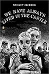</a>

    

    

    

    

    
<a title="The Story of My Teeth" rel="nofollow" href="https://www.goodreads.com/book/show/24796231-the-story-of-my-teeth">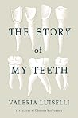</a>

    
<a title="Resilient: How to Grow an Unshakable Core of Calm, Strength, and Happiness" rel="nofollow" href="https://www.goodreads.com/book/show/36025434-resilient">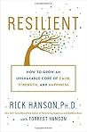</a>

    
<a title="The Leader's Book of Inspiration: Quotes and Insights for Today's Leaders (Inspiration Series 1)" rel="nofollow" href="https://www.goodreads.com/book/show/43461128-the-leader-s-book-of-inspiration">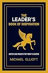</a>

    
<a title="The Book Of Shaders" rel="nofollow" href="https://www.goodreads.com/book/show/53350426-the-book-of-shaders">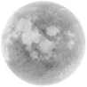</a>

    
<a title="Frankenstein: The 1818 Text" rel="nofollow" href="https://www.goodreads.com/book/show/35031085-frankenstein">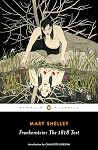</a>

    

    
<a title="Superforecasting: The Art and Science of Prediction" rel="nofollow" href="https://www.goodreads.com/book/show/30268520-superforecasting">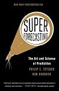</a>

    
<a title="Design Justice: Community-Led Practices to Build the Worlds We Need" rel="nofollow" href="https://www.goodreads.com/book/show/51151807-design-justice">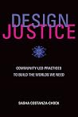</a>

    
<a title="Weapons of Math Destruction: How Big Data Increases Inequality and Threatens Democracy" rel="nofollow" href="https://www.goodreads.com/book/show/28186015-weapons-of-math-destruction">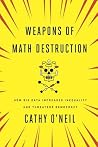</a>

    

    

    

    

    

      <a class="gr_grid_branding" style="font-size: .9em; color: #382110; text-decoration: none; float: right; clear: both" rel="nofollow" href="https://www.goodreads.com/user/show/54140412-gary-crossey">Gary Crossey's favorite books »</a>
  <noscript> Share <a rel="nofollow" href="/">book reviews</a> and ratings with Gary, and even join a <a rel="nofollow" href="/group">book club</a> on Goodreads.</noscript>
  

      

      
