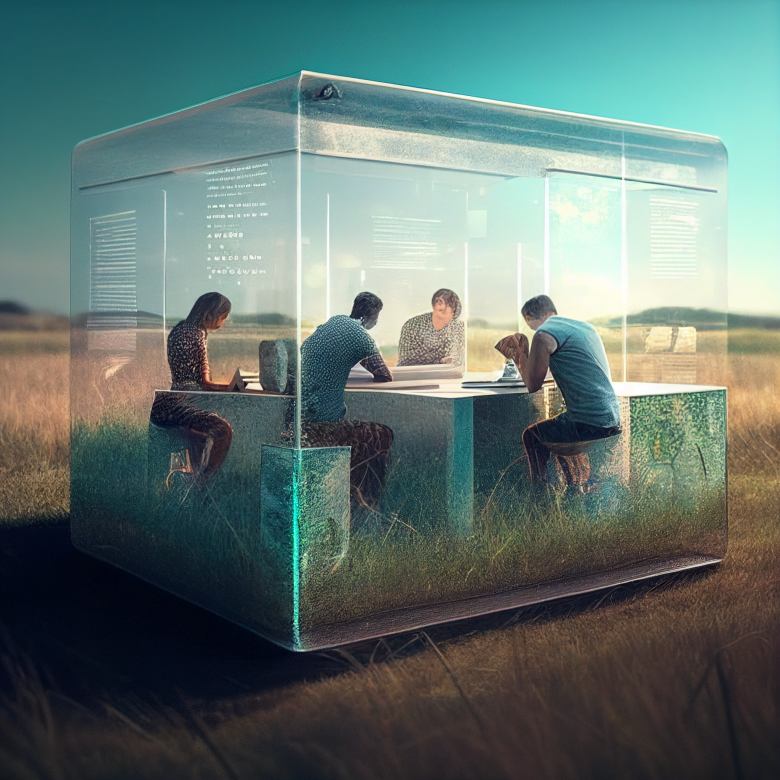

<figure class="wp-block-image size-full"></figure>

<h2 class="has-text-color has-large-font-size wp-block-heading" style="color:#ed0188">Are you struggling to manage complex WordPress websites?</h2>

Some useful WordPress plugins and tips that can help you improve your website's functionality.

<a class="wp-block-button__link has-background wp-element-button" href="https://www.meetup.com/sandy-mush-wordpress-meetup-group/events/291031793/" style="border-radius:20px;background-color:#ed0188" target="_blank" rel="noreferrer noopener">Meetup Link - To Event Page</a>

<h3 class="wp-block-heading">Plugins</h3>

<strong>Activity Log:</strong> This plugin will keep track of every change made to your WordPress site, including posts, pages, users, and plugins. With this plugin, you will be able to identify and fix issues quickly.

<strong>Duplicate Page:</strong> This plugin allows you to duplicate any page or post on your WordPress site with a single click. You can save time and effort by using this plugin to create new pages or posts that are similar to existing ones.

<strong>Download Monitor:</strong> This plugin is ideal for those who offer downloads on their WordPress site. With this plugin, you can monitor and track the number of downloads, and also restrict access to files.

<strong>WP Mail Logging:</strong> This plugin logs all outgoing emails sent from your WordPress site, allowing you to troubleshoot email-related issues quickly.

<strong>WP Mail SMTP:</strong> This plugin configures WordPress to use a proper SMTP provider when sending emails, ensuring that your emails are delivered successfully and not marked as spam.

<strong>Redirection:</strong> This plugin allows you to manage 301 redirects and keep your site's pages accessible to visitors even if the URLs have changed. It also tracks 404 errors and provides suggestions for fixing them.

<strong>Simple Custom CSS and JS &amp; WP Add Custom CSS</strong> is a plugin that allows you to add custom CSS and JavaScript to your WordPress site, giving you greater control over the appearance and functionality of your website. With this plugin, you can add custom code to individual pages or posts, or to your entire site. This is useful for making design tweaks or adding new features to your site without having to modify the theme code directly.

<h3 class="wp-block-heading">Maintenance Tips</h3>

<strong>Keep your WordPress site up-to-date:</strong> Always ensure that your WordPress site is running the latest version. Upgrades often include security patches and bug fixes. Don't assume that all plugins can be auto updated. 

<strong>Backup your website regularly:</strong> Use a reliable backup method to ensure that your website's data is safe and can be restored if necessary. Test how long your backups take to restore and manage accordingly.  

<h3 class="alignfull has-text-align-center has-tertiary-color has-foreground-background-color has-text-color has-background wp-block-heading">Assorted Musings</h3>

ACHIEVE GOALS

<figure class="wp-block-embed is-type-wp-embed is-provider-better-world-with-design wp-block-embed-better-world-with-design">

<blockquote class="wp-embedded-content" data-secret="9MLxINxUEx"><a href="https://betterworldwithdesign.com/password-mantra/">Password Mantra</a></blockquote><iframe loading="lazy" class="wp-embedded-content" sandbox="allow-scripts" security="restricted" style="position: absolute; visibility: hidden;" title="&#8220;Password Mantra&#8221; &#8212; Better World With Design" src="https://betterworldwithdesign.com/password-mantra/embed/#?secret=CwCDSXbGZB#?secret=9MLxINxUEx" data-secret="9MLxINxUEx" width="600" height="338" frameborder="0" marginwidth="0" marginheight="0" scrolling="no"></iframe>

</figure>

DESIGN BOOK REVIEW 

<figure class="wp-block-embed is-type-wp-embed is-provider-better-world-with-design wp-block-embed-better-world-with-design">

<blockquote class="wp-embedded-content" data-secret="bHQNGX07zW"><a href="https://betterworldwithdesign.com/design-justice-community-led-practices-to-build-the-worlds-we-need/">Design Justice</a></blockquote><iframe loading="lazy" class="wp-embedded-content" sandbox="allow-scripts" security="restricted" style="position: absolute; visibility: hidden;" title="&#8220;Design Justice&#8221; &#8212; Better World With Design" src="https://betterworldwithdesign.com/design-justice-community-led-practices-to-build-the-worlds-we-need/embed/#?secret=nr4iT0jVdk#?secret=bHQNGX07zW" data-secret="bHQNGX07zW" width="600" height="338" frameborder="0" marginwidth="0" marginheight="0" scrolling="no"></iframe>

</figure>

