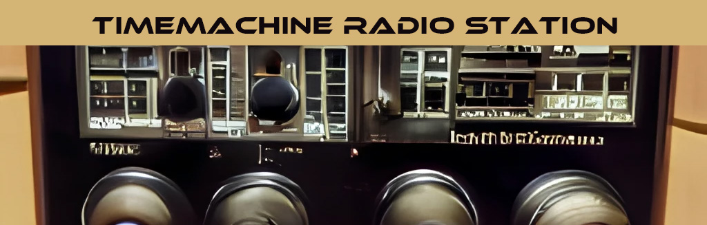
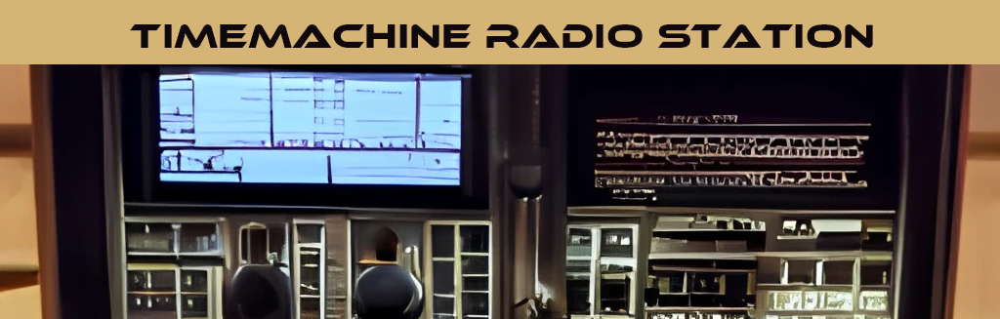

<figure class="wp-block-image size-full"></figure>

<a href="http://radiooooo.com/" target="_blank" rel="noreferrer noopener">Radiooooo.com</a>:  Global Radio Station Time Machine

<!--more-->

Do you ever find yourself wanting to listen to the music of a different time and place? Or perhaps you're curious about the popular songs from a country you've never been to before. Look no further than <a href="http://radiooooo.com/" target="_blank" rel="noreferrer noopener">Radiooooo.com</a>, the super fun global radio station time machine.

<h3 class="wp-block-heading">Travel Through Time and Space</h3>

<a href="http://radiooooo.com/" target="_blank" rel="noreferrer noopener">Radiooooo.com</a> allows users to select a country and a decade, and then streams popular songs from that time and place. Want to listen to French music from the 1950s? No problem. How about Nigerian music from the 1970s? You got it. The website's interface is incredibly user-friendly and the selection of music is vast.

<h3 class="wp-block-heading">Discover New Music and Cultures</h3>

One of the best things about <a href="http://radiooooo.com/" target="_blank" rel="noreferrer noopener">Radiooooo.com</a> is the opportunity to discover new music and cultures. Whether you're a music lover or just someone who wants to broaden their horizons, the website has something for everyone. You can spend hours exploring the different countries and decades, and you're sure to find something that you haven't heard before.

<h3 class="wp-block-heading">Share Your Discoveries</h3>

Another great feature of <a href="http://radiooooo.com/" target="_blank" rel="noreferrer noopener">Radiooooo.com</a> is the ability to share your discoveries with others. The website allows users to create custom playlists and share them on social media. This is a great way to introduce your friends and family to music they may have never heard before.

<a href="http://radiooooo.com/" target="_blank" rel="noreferrer noopener">Radiooooo.com</a> is a fantastic resource for anyone looking to travel through time and space with music. The website is easy to use and offers a vast selection of music from all over the world. Whether you're looking to discover new music or just want to take a trip down memory lane, <a href="http://radiooooo.com/" target="_blank" rel="noreferrer noopener">Radiooooo.com</a> has got you covered. So what are you waiting for? 

<figure class="wp-block-image size-full"></figure>
