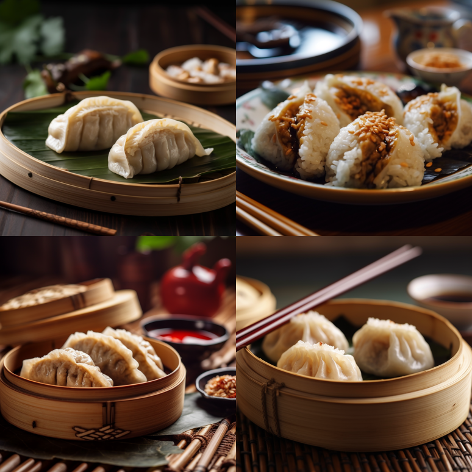

<figure class="wp-block-image size-full"></figure>

<h2 class="wp-block-heading has-large-font-size">Unleashing Your Creativity: A Beginner's Guide to Using AI Prompts for Your New Hobby</h2>

A Beginner's Guide to Using AI Prompts for Your New Hobby is a quick guide designed to help you explore and develop your new hobby or interest using AI-generated prompts. With a wide range of thought-provoking questions and creative prompts, this guide is perfect for anyone looking to unleash their creativity and dive deeper into their passion. Whether you're interested in cooking, writing, photography, or anything in between, this guide offers useful tips, tricks, and inspiration to help you get started and make the most of your new hobby. Start exploring your interests today and discover a whole new world of creative possibilities!

<h2 class="wp-block-heading alignfull has-text-align-center has-background-color has-foreground-background-color has-text-color has-background" style="text-transform:uppercase">AI Prompt </h2>

<h4 class="wp-block-heading has-text-color has-large-font-size" style="color:#d64b01"><strong>I want to get started with learning how to make [Chinese Dumplings]</strong>(can be any topic)</h4>

— What are some good YouTube channels to check out? — What is the best way to start exploring this new hobby? — What are some essential things a beginner should know?

For my example I entered the topic<strong> Chinese Dumplings</strong>. The Result below is what AI (<em>mostly</em>) generated. With all AI results expect to review, revise, and verify the content. 

<strong>Apply this AI Prompt to any topic and generate your own results. </strong>

<h2 class="wp-block-heading alignfull has-text-align-center has-background-color has-foreground-background-color has-text-color has-background" style="text-transform:uppercase">AI Result </h2>

<h2 class="wp-block-heading">YouTube Channels</h2>

There are many YouTube channels that can help you learn how to make Chinese dumplings. Some popular ones include:

<ul class="wp-block-list">
<li><a href="https://www.youtube.com/c/ChineseCookingDemystified">Chinese Cooking Demystified</a></li>

<li><a href="https://www.youtube.com/c/TheDumplingSisters">The Dumpling Sisters</a></li>

<li><a href="https://www.youtube.com/c/SoupedUpRecipes">Souped Up Recipes</a></li>
</ul>

<h2 class="wp-block-heading">Getting Started</h2>

The best way to start exploring this new hobby is to practice making dumplings. Start with a basic recipe and work your way up to more complex ones. Here are some steps to follow:

<ol class="wp-block-list">
<li>Gather all of the necessary ingredients and equipment.</li>

<li>Find a recipe that you want to try.</li>

<li>Watch videos or read instructions to learn how to prepare the dough and filling.</li>

<li>Practice making the dumplings until you are comfortable with the process.</li>
</ol>

<figure class="wp-block-image size-full"></figure>

<h2 class="wp-block-heading">Essential Tips</h2>

Here are some essential things a beginner should know:

<ul class="wp-block-list">
<li>Use the right flour: Dumpling wrappers are typically made with wheat flour, which has a lower gluten content than all-purpose flour.</li>

<li>Don't overfill the dumplings: Overfilling can cause the dumplings to burst during cooking.</li>

<li>Use a damp cloth to cover the dough: This will prevent the dough from drying out while you are working with it.</li>

<li>Pinch the edges of the wrapper tightly: This will help ensure that the filling stays inside the dumpling during cooking.</li>
</ul>

With these tips, you should be well on your way to making delicious Chinese dumplings. Happy cooking!

AI Prompt - Copy and Paste into your AI app of choice. 

<strong>I want to get started with learning how to make [any topic]</strong>

— What are some good YouTube channels to check out? — What is the best way to start exploring this new hobby? — What are some essential things a beginner should know?

