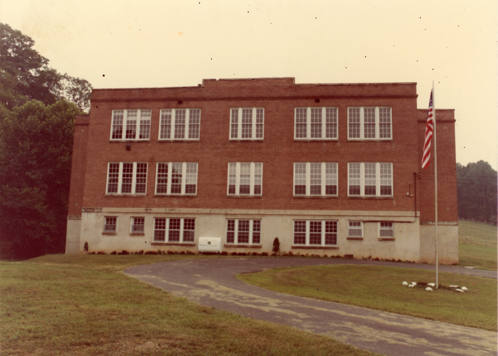

<h4 class="et_pb_module_header">Empowering Rural Communities Through Tech</h4>

<h1 class="et_pb_module_header">Revolutionizing Local Landscapes with Digital Tools</h1>

Explore how innovative technology can transform rural life, fostering community resilience and sustainable growth.

<h2 class="et_pb_module_header">Empowering Rural Innovation</h2>

Sandy Mush stands at the crossroads of rural tradition and digital opportunity. As a grassroots movement bridging the digital divide, we're fostering local talent and championing sustainable tech solutions that empower our community through education and hands, on access to digital tools. Our mission is rooted in authenticity, honoring the unique challenges and opportunities of rural life while building a future where technology serves people, not the other way around. <!-- notionvc: 28fd840e-4a6d-42f2-8ceb-4ccf811f3d68 -->

<h2 class="et_pb_module_header">Building Community Through Connection: Why Sandy Mush Needs a Local Tech Network</h2>

I've called Sandy Mush home for over twenty years now. When I first arrived in this beautiful corner of Western North Carolina, I was running a tech business from what many would consider the middle of nowhere. Back then, I was running my entire web and SEO business off cell data from my phone. I was grandfathered into an unlimited plan and was burning through about 150GB a month, for well over a decade. I could power three computers from that one connection. We were fortunate to live on a ridge that had the only reliable cell service for six miles in any direction. For our neighbors, even that option didn't exist.

But I believed in something that seemed impossible to most people at the time: that you could do serious tech work from a rural community. That you didn't need to live in Silicon Valley or a major city to participate in the digital economy. That a place like Sandy Mush, with its stunning mountain views and tight-knit community, could be exactly where you need to be.

Over these two decades, I've proven that belief true. I've built websites, managed digital marketing campaigns, and developed solutions for clients across the world—all from my home here in Sandy Mush. But more importantly, I've watched this community evolve. I was part of the years-long effort to bring fiber optic internet to our area, knowing that fast, reliable connectivity would be transformative for our neighbors.

<h2 style="text-align: left;">What Eight Years of Community Tech Work Has Taught Me</h2>

For the past eight years, I've had the privilege of volunteering with the Sandy Mush Community Center in a role that has become central to how I think about technology's potential to strengthen rural communities. I've led the communications team, developed and maintained the SMCC website, managed their social media presence, created custom graphics and animations for their events, designed monthly book club materials, produced their newsletter, and provided tech training and works to community members.

This work has shown me something powerful: when one person with technical skills embeds themselves in a community organization, the ripple effects are substantial. Our community center now has a modern digital presence that helps us reach more people, share our story more effectively, and coordinate events more efficiently. We've hosted everything from Spring Fling to our annual Bingo Season, and having strong digital tools has made each event more successful.

I think about last year's Trunk or Treat event, which we coordinated with businesses like Method Q. Their generous candy donation helped make the event a huge success, and we were able to spread the word effectively through our digital channels, bringing families from across the area together for an evening of community connection.

Our communication infrastructure has grown significantly over eight years. We've built a mailing list of just over 400 people, and when we send out an email news blast, more than 50% of our local subscribers open the email within minutes. During difficult times, this newsletter has been invaluable for keeping our community connected and informed. We've worked hard to maintain these contacts, cleaning the list multiple times over the years to ensure it remains effective.

I'm particularly proud that I pushed for the Google Grant, even when board members worried it would be underutilized. Today, that grant powers our Google Calendar embedded on the SMCC website—now our most visited page. We're continuing to expand our digital reach, with plans to broadcast board meetings so more community members can participate and stay informed, regardless of their ability to attend in person.

But here's what keeps me up at night: What if this impact could be multiplied? What if more people in Sandy Mush had access to the skills, connections, and support that enable remote work and digital entrepreneurship? What if we could build local wealth and opportunity without anyone having to leave the place they love?

<h2 style="text-align: left;">Learning from Asheville's Remote Worker Community</h2>

I've watched with interest as Asheville has become the seventh fastest-growing tech hub in the nation. But what's particularly relevant to Sandy Mush is how Asheville Digital Nomads grew—not by importing workers from elsewhere, but by connecting people who were already in the area and seeking community and collaboration.

That model resonates deeply with me because it's not about changing who we are or attracting outsiders to colonize our rural spaces. It's about recognizing and supporting the people who are already here, who already love this place, and who could benefit from better access to remote work opportunities.

I know our neighbors. I know the young parents who wish they could work from home to be closer to their kids. I know the talented craftspeople who could reach broader markets if they understood e-commerce better. I know the retirees with decades of professional experience who would love to mentor the next generation. I know the teenagers who assume they'll have to leave Sandy Mush to find good careers.

All of these people are already here, already part of our community fabric. They don't need to be attracted or recruited—they need to be connected and empowered.

<h2 style="text-align: left;">A Vision Rooted in What Already Works</h2>

My vision for a Sandy Mush tech network isn't about building something from scratch or importing an urban model to rural spaces. It's about scaling what already works. The Sandy Mush Community Center has benefited from having embedded tech expertise for nearly a decade. Imagine if we could extend similar support to more local residents.

This could start simply: monthly co-working pop-ups at the community center where remote workers and freelancers gather to work alongside each other. Skills exchange programs where a farmer learns social media marketing while a developer discovers regenerative agriculture. Tech literacy workshops that help people set up home offices, understand cybersecurity basics, or navigate digital accessibility.

We could create founder circles—small groups of entrepreneurs and aspiring business owners who meet monthly for peer accountability and support. We could offer digital tune-ups for local businesses, providing accessible, repeatable support for organizations hesitant about technology adoption.

The goal isn't growth for growth's sake. It's not about expanding our footprint or changing our rural character. It's about building community wealth and creating opportunities for people who already call Sandy Mush home to participate more fully in the digital economy while staying rooted in place.

<h2 style="text-align: left;">Why This Matters Now</h2>

Remote work isn't a temporary trend—it's a fundamental shift in how work happens. The companies hiring remotely aren't just tech startups; they're healthcare organizations, financial services firms, educational institutions, nonprofits, and countless others. These opportunities exist, but many of our neighbors don't know how to access them or don't believe they're available to people in rural areas.

I've proven for twenty years that you can do serious professional work from Sandy Mush. Now I want to help others discover that same possibility. Not by convincing them to become something they're not, but by connecting them with resources, skills, and each other.

We have fiber optic internet now—infrastructure that many rural communities would envy. We have proximity to Asheville's growing tech ecosystem without losing our distinct identity. We have a strong community center that already serves as a gathering place. We have talented, dedicated people who love this place and want to see it thrive.

What we need is intentional connection. A platform where locals can plug into remote work opportunities, develop digital skills, access mentorship, and support each other's entrepreneurial ventures. A network that serves our community first, built on the foundation of trust and infrastructure we've already established.

<h2 style="text-align: left;">An Invitation to Build Together</h2>

This isn't my vision alone—it's an invitation. I've spent eight years supporting one organization and have seen the impact that focused technical expertise can have. But I'm just one person, and our community has so much more potential waiting to be unlocked.

If you're a local resident interested in remote work, I want to connect with you. If you're already working remotely and feel isolated, let's build community together. If you have skills to share or skills you want to learn, you're exactly who this network needs. If you're worried about whether someone with your background could access these opportunities, I especially want to hear from you.

Twenty years ago, I chose Sandy Mush because I believed you could do meaningful work from anywhere. Today, I'm more convinced than ever that rural communities like ours don't need to compromise between economic opportunity and quality of life. We don't need to expand our footprint or change our character to thrive. We need to connect the people and resources already here in more intentional ways.

That's the work I'm committed to, and I hope you'll join me in building it. Not someday, not when conditions are perfect, but now—starting with simple steps, building on what already works, and trusting that our community has everything it needs to create the future we want to see.<!-- notionvc: d787671a-b2db-45df-a78d-fa167d991f8c -->

<!-- notionvc: 8ef4eaef-919a-432b-9da3-b6ce4b914f6a -->

<!-- notionvc: d2748d09-7a0c-4c77-ab76-52b3e44d9205 -->

<h2 class="et_pb_module_header">The Rise of Digital Nomads</h2>

&nbsp;

<h3 style="text-align: left;">Practical First Steps (Low-Lift, High-Value)<!-- notionvc: d787671a-b2db-45df-a78d-fa167d991f8c --></h3>

<!-- notionvc: d2748d09-7a0c-4c77-ab76-52b3e44d9205 -->

<h3 class="title">Co-working pop-up days at community venues.</h3>

<h3 class="title">Fiber literacy and home-office setup clinics.</h3>

<h3 class="title">Skills exchange bulletin + micro-mentorships.</h3>

<h3 class="title">Founder huddles: monthly peer sessions for accountability.</h3>

<h3 class="title">Local business digital tune-ups: short, repeatable clinics.</h3>

<h2 class="et_pb_module_header">Safeguards for Rural Character</h2>

<ul>
<li style="text-align: left;">Community-first programming and open participation.</li>
<li style="text-align: left;">Support agri-tech and local food ecosystems alongside software.</li>
<li style="text-align: left;">Encourage distributed, small-footprint workspaces vs. large campuses.</li>
</ul>
<h2 style="text-align: left;">Expanding on the Core Benefits</h2>

The transformation of Sandy Mush into a rural tech hub rests on three interconnected pillars that together create a sustainable model for community-driven innovation. Each element reinforces the others, building a resilient ecosystem that honors rural character while embracing digital opportunity.<!-- notionvc: d38cf4ec-55c0-4d6b-906d-d391028e2da4 -->

<!-- notionvc: d2748d09-7a0c-4c77-ab76-52b3e44d9205 -->

<h2 class="et_pb_module_header">Latest Insights on Tech & Community</h2>

<form class="et_pb_searchform" method="get" role="search" action="https://betterworldwithdesign.com/">
<label class="screen-reader-text" for="s">Search for:</label><input name="s" class="et_pb_s" type="text" placeholder="Search Posts" value="" /><input name="et_pb_searchform_submit" type="hidden" value="et_search_process" /><input name="et_pb_include_pages" type="hidden" value="yes" /><input name="et_pb_include_posts" type="hidden" value="yes" />
</form>

